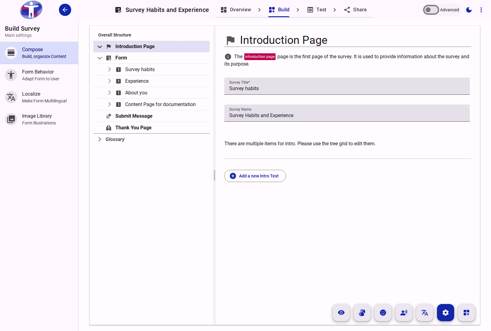
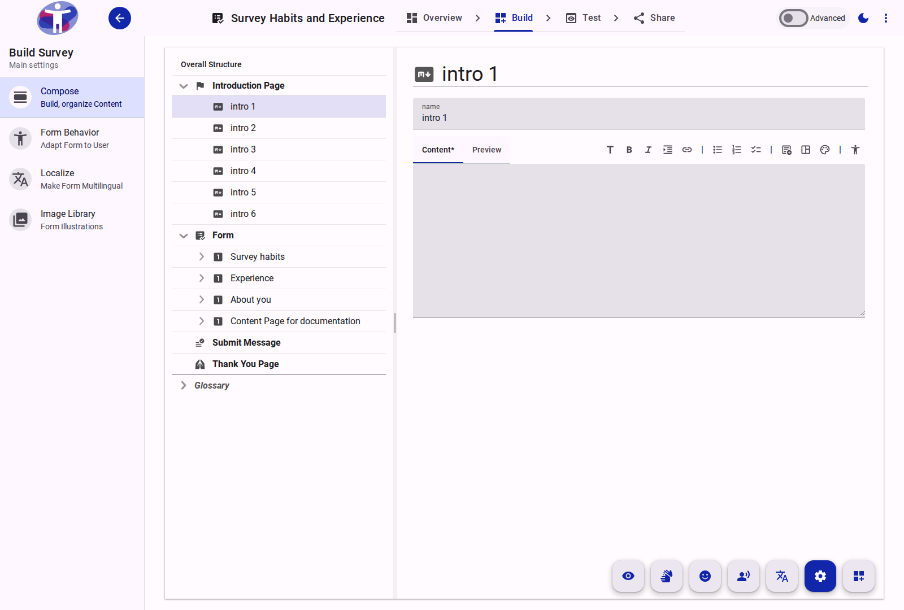

# Text Page Reference

The survey builder distinguishes between two categories of informational text elements: **Survey-Level Text Variants** (structural pages that bookend the questionnaire) and **Standalone Text Items** (inlined content blocks placed within Pages and Sections).

<figure>
  
  <figcaption>The Introduction Page selected in the Build → Compose structure tree.</figcaption>
</figure>

## Survey-Level Text Variants

Survey-level text variants sit outside the Form container in the Compose tree. They define the introductory framing, legal terms, and completion screens:

| Variant | Tree Identifier | Required | Key Properties | Purpose |
| :--- | :--- | :--- | :--- | :--- |
| **Introduction** | `intro` | Yes | Survey Name, Survey Title, Markdown Body | Welcomes respondents, sets expectations, and provides the questionnaire start action. Editing Survey Name here renames the survey. |
| **Terms and Conditions** | `terms` | Optional (`hasTerms`) | Appearance (`dialog` or `plain`), Acceptance Label | Presents legal terms and privacy notices that respondents must accept before proceeding to questionnaire data collection. |
| **Pre-Submit Page** | `submit` | Optional | Review Instructions, Pre-Submit Body | Provides a transitional review screen or final consent notice immediately prior to the respondent clicking Submit. |
| **Thank You Page** | `thanks` | Yes | Completion Body, Redirection URL | Displays completion acknowledgment, submission confirmation receipts, and outbound survey links. |

<figure>
  
  <figcaption>Editing markdown content and media attachments on a survey text item.</figcaption>
</figure>

### Terms and Conditions Configuration

Terms are activated from **Share → Terms** or by enabling `hasTerms: true` on the survey entity:

- **Dialog Mode (`dialog`):** Renders a concise agreement checkbox with a link to open the full terms in an accessible modal dialog. The respondent must confirm the dialog before checking the agreement.
- **Plain Mode (`plain`):** Displays the full markdown terms directly inline above the acceptance checkbox on the screen.
- **Refusal Handling:** If a respondent declines the terms or navigates away without agreeing, the response session terminates without recording answers and can trigger a `survey.terms.refused` webhook.

## Standalone Text Items (`a11y-text`)

Standalone text items are modular content blocks added inside Pages or Sections alongside questions. They are used for section introductions, transition guidance, reading passages, or accessibility notices.

### Properties and Capabilities

- **Markdown Content:** Rich-text authoring supporting headers, lists, links, blockquotes, tables, and custom embedded components (such as `<a11y-menu></a11y-menu>` or `<lapp-tooltip>`).
- **Media Attachments:** Images or diagrams uploaded directly to survey media storage (`media-text`) and embedded in the text block.
- **Visibility Logic:** Can carry conditional visibility rules (`createVisibilityLogic`). A text block can appear or disappear dynamically based on respondent answers elsewhere in the survey.
- **Fixed Position (`props.fixed`):** If the parent Section or Page has `randomize` enabled, toggling **Fixed Position** ensures this text block maintains its original authored placement (for example, keeping introductory instructions at the top of a randomized section).

### End Page in "One Question At A Time" Mode

When the survey form operates in conversational mode (`presentationMode: 'oneQuestionAtATime'`), standalone text items have special pagination behavior:

- **Default (Off):** The text block renders directly above the question that immediately follows it on the same screen, acting as question-level introductory context.
- **End Page (On):** Toggling on the **End Page** (`endPage`) switch forces the text block to occupy its own dedicated, full-screen page. The respondent reads the informational content and clicks **Next** before reaching subsequent questions.

::: tip Use Cases for End Page
Enable **End Page** when introducing major thematic shifts, presenting extended reading passages in cognitive evaluations, or displaying mid-survey instructions that should not be visually attached to a single input field.
:::

## Localization

All survey text variants and standalone text items support full internationalization:

- Each language has its own localized document under `items/{textId}/locale/{language}`.
- Switching to **Localize Mode** in Build → Compose or Build → Localize displays text blocks side-by-side with the primary language for direct human translation or batch machine translation.
