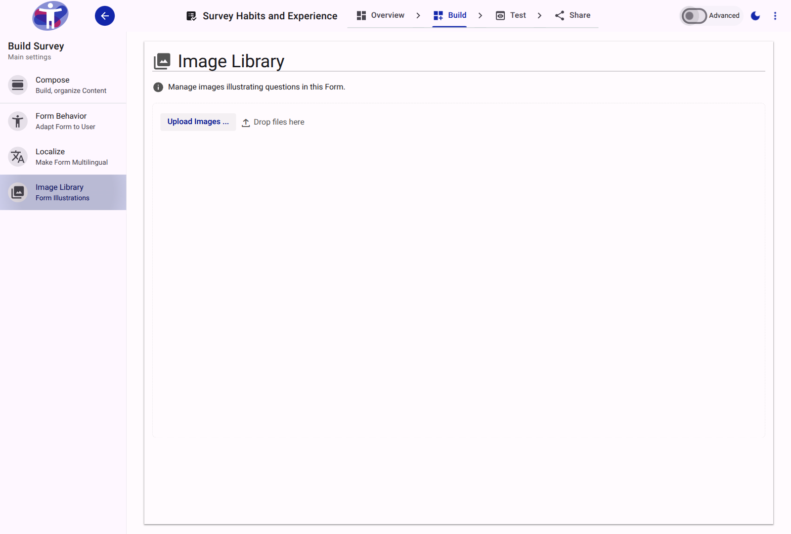

# Image Library Reference

The **Image Library** provides a centralized gallery for managing visual assets—such as Easy Read illustrations, organization logos, and explanatory diagrams—used throughout the survey form.

<figure>
  
  <figcaption>The Image Library displaying uploaded media assets.</figcaption>
</figure>

## Uploading Media

Click **Upload Images ...** to upload files from your device. The upload component supports:

- **Supported Media Types:** Images and videos (`accept="image/*, video/*"`), including PNG, JPEG, SVG, WebP, GIF, and MP4.
- **Maximum File Size:** Up to **5 MB** per file (`5,000,000` bytes). Files exceeding 5 MB will be rejected by the uploader.
- **Recommended File Size:** We recommend keeping Easy Read images under **400 KB** to optimize load times for mobile respondents, ideally using square (1:1) aspect ratios for layout consistency.
- **Form Capacity:** Up to **10,000** media files can be attached to a single survey form.

## Gallery Management

Uploaded assets are organized in the media gallery grid (`lapp-media-gallery`):

- **Selection:** Click items to select them individually, or use multi-select to select several items at once.
- **Preview:** Inspect full-resolution images and video playback directly in the gallery.
- **Download:** Download any uploaded asset back to your computer.
- **Delete:** Remove unneeded assets from the library. *Note: Ensure an image is not actively used in a question or Easy Read illustration before deleting it.*

## Using Images in Surveys

Once uploaded, assets in the Image Library can be referenced across your survey:

- **Easy Read Illustrations:** Assign images directly to questions or sections in Easy Read mode via the Compose tree.
- **Free-Text Content:** Embed images within Markdown text blocks, question descriptions, or introduction pages using the rich text editor's image insertion tool or standard Markdown syntax.

## Related Content

- [Adding Images to the Library How-to Guide](../../how-to/adding-images-to-library.md) — Step-by-step image management workflow
- [Using Easy Read How-to Guide](../../how-to/use-easy-read.md) — Illustrating questions with Easy Read images
- [Markdown Reference: Web Components](../content/markdown/available-web-components.md) — Formatting and embedding media in survey text
