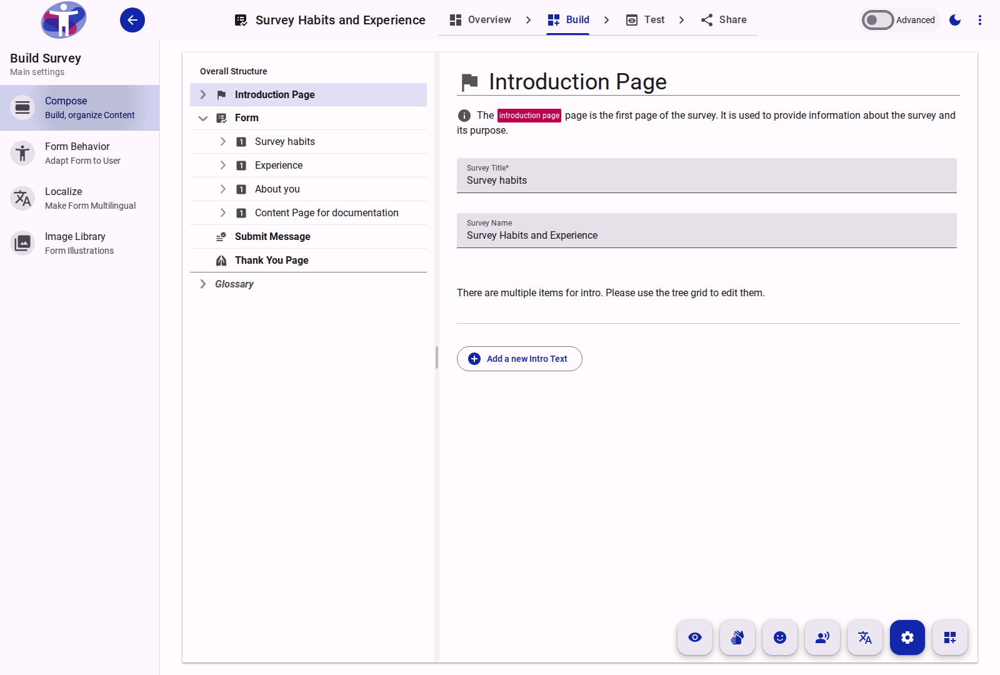
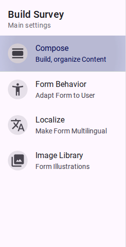

# Survey Builder Reference

The Survey Builder is the primary authoring workspace for creating, structuring, translating, and refining survey questionnaires. It provides tools for defining content, visual presentation, accessibility features, and quality checks.

## Interface Overview

The Survey Builder drawer provides access to the following tools:

- **[Compose](./compose/index.md)**: Structure the questionnaire by adding pages, sections, and questions, and authoring text content.
- **[Form Behavior](./behavior.md)**: Configure questionnaire layout (e.g. one question per page), accessibility modes (Read Aloud, Easy Read, Sign Language), and visual styling tokens.
- **[Localize](./localize.md)**: Enable multilingual support and activate supported survey languages.
- **[Image Library](./image-library.md)**: Upload and manage image and video assets (up to 5 MB per file) used as question illustrations or Easy Read graphics.
- **[Review](./review.md)**: Audit questionnaire quality with automated rule checks and AI reviews, applying one-click fixes for logic, translation, and accessibility issues.
- **[Shared Options](./shared-options.md)**: Manage named answer-option lists reused across choice questions.
- **[Expressions](./expressions.md)**: Index every logical expression, its usage and its deletion status.

### Advanced Mode Tools

Enabling **Advanced Mode** in the toolbar reveals additional engineering and recovery tools:

- **[Prompt](./prompt.md)**: Audit the history of AI drafting prompts and parameters used to generate survey content.
- **[Restore](./restore.md)**: Recover soft-deleted questions, pages, sections, or shared logical expressions.

<figure>
  
  <figcaption>The Survey Builder interface displaying the main editing workspace.</figcaption>
</figure>

<figure>
  
  <figcaption>The navigation drawer for accessing Builder tools.</figcaption>
</figure>

## Publishing and Survey Lifecycle

Drafting changes in the Survey Builder does not immediately affect respondents in the field. When your questionnaire is ready:

1. **Review**: Check for broken logic, missing translations, or accessibility barriers in [Review](./review.md).
2. **Build**: Compile an immutable version of your questionnaire in [Share → Publish](../share/publish/index.md).
3. **Status & Distribution**: Set your opening schedule in [Share → Status](../share/status/index.md) and generate live links or invite audiences in [Share → Distribute](../share/distribute/index.md).
