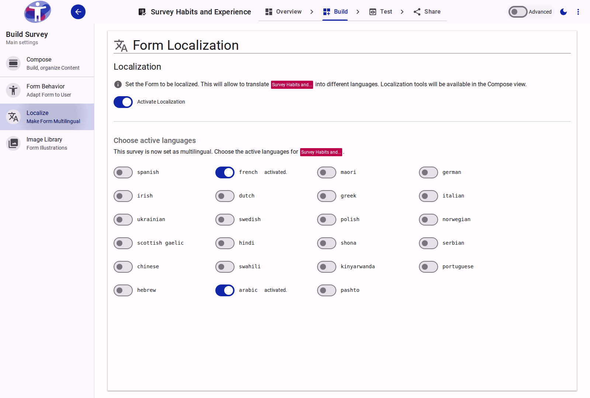
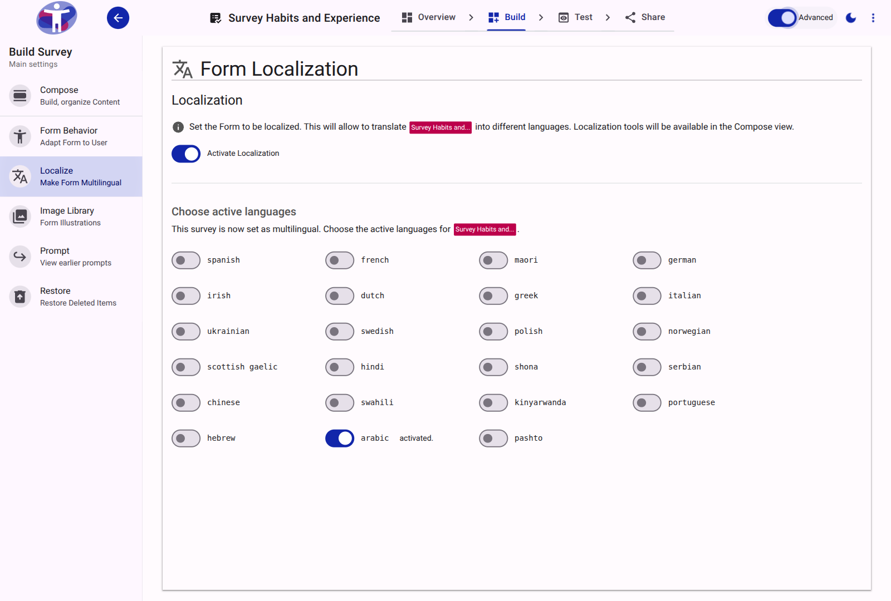

# Localize Reference

The Localize tool manages the translation of the survey into multiple languages. It allows administrators to review, manage, and import/export translations for form fields, labels, and pages.

<figure>
  
  <figcaption>The main view for managing survey translations.</figcaption>
</figure>

## Advanced Configuration and Export

In advanced mode, administrators have access to deeper technical controls, including the ability to export translation templates as JSON files for external processing and import completed translations back into the platform.

<figure>
  
  <figcaption>The advanced view of the Localize tool.</figcaption>
</figure>

## Translation Process

The tool supports automatic base translation for empty fields and manual overrides. Content can also be securely exported to a structured JSON format, handed off to professional translation services, and safely re-imported.

## Email Messages

When a survey has active email messages (created by turning on invitations on **Share → Distribute** or ticking a purpose on **Share → Email**), the Compose tree includes an **Email** group row below **Terms and Conditions**. Expand **Email** in **Localize Mode** to translate each message item's **Subject** and **Body** in the active language side by side with the primary language; the **Translation** column in the tree shows the translated subject. The **Translate** action and JSON translation **Import/Export** include every active email item automatically; the override choice applies to them as it does to the rest of the survey. See the [Email Reference](../share/email/index.md#email-items-in-compose-and-localize) for details.
