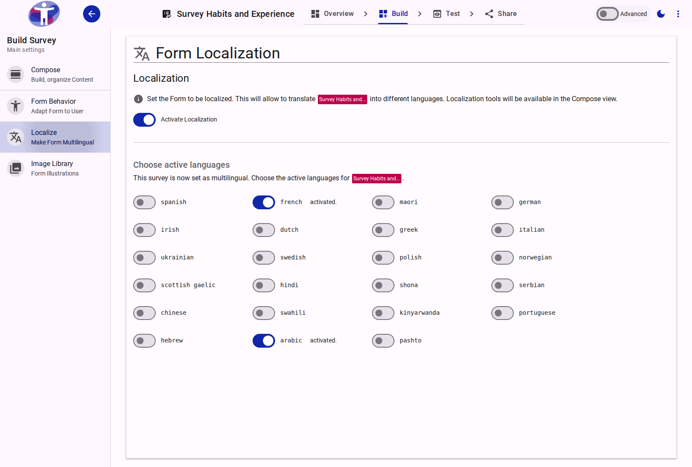

# Localize Reference

The **Localize** page provides controls to enable multilingual support for your survey and activate the languages you want to offer to respondents.

<figure>
  
  <figcaption>The Localize view displaying the Activate Localization toggle and language options.</figcaption>
</figure>

## Overview

By default, a survey is configured in a single primary language. The **Localize** view allows authors to turn the survey into a multilingual form:

- **Activate Localization Switch (`isLocalized`)**: Enables multilingual support. Once activated, localization controls become available across the Survey Builder.
- **Choose Active Languages**: Displays switches for all languages supported by your organization (configured under [Customer Portal Settings](../../../customer/reference/customer/theme.md)). Toggling a switch activates that language for this survey.

## Translating Your Survey

Activating languages on this page unlocks translation workflows in the Survey Builder:

- **Compose View (Localize Mode)**: Open **Build → Compose** and switch to **Localize Mode** in the bottom toolbar. This displays a side-by-side editing interface where you can translate question labels, options, supporting text, and email messages for each active language.
- **AI Translate Action**: Use the AI translation tool in Compose to automatically generate translations across missing fields.
- **Review Panel**: The [Review](./review.md) panel automatically audits all active languages and flags any untranslated questions, options, or messages.

::: tip Offline Translation with JSON Files
Exporting and importing translation files does not take place in this drawer. To export survey content to a JSON file for professional translators, bulk-edit sign language video IDs, or import completed translations, use [Share → Import/Export](../share/import-export/index.md).
:::

## Email Messages in Multilingual Surveys

When a survey has active email messages (invitations, confirmations, reminders, or follow-ups), an **Email** group appears in the Compose tree. When **Localize Mode** is active, you can translate each message's **Subject** and **Body** side by side with the primary language.

## Related Content

- [How to Localize a Survey](../../how-to/localize-survey.md) — Step-by-step translation guide
- [Import/Export Translations Reference](../share/import-export/index.md) — Exporting and importing JSON translation packages
- [Compose Reference](./compose/index.md) — Side-by-side translation in Localize Mode
