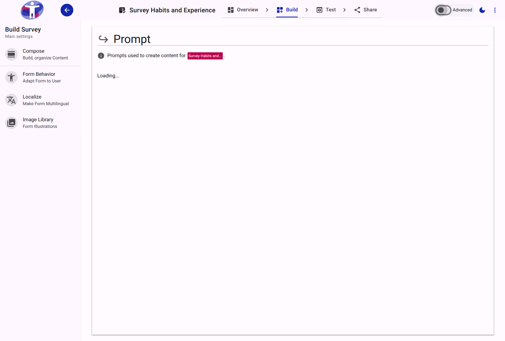

# Prompt Reference

The **Prompt** page maintains a historical record of all AI prompts and generation requests used to draft, generate, or refine content for this survey form.

<figure>
  
  <figcaption>The Prompt history view displaying previous AI generation prompts.</figcaption>
</figure>

## Overview

When survey authors use AI-assisted drafting tools—such as generating questions, expanding sections, or suggesting question options—the platform records the prompt instructions, parameters, and timestamps in the form's prompt history.

This audit trail helps survey authors:

- Review the exact prompts, instructions, and context used to generate content.
- Track when and where AI-generated elements were introduced into the questionnaire.
- Refine and reuse successful prompts across other sections or surveys.

::: info Looking for Glossary Tooltips?
This page documents **AI generation prompts**, not definition tooltips for respondents. To configure interactive glossary terms and tooltips that explain complex words to respondents, see:

- [Using Tooltips How-to Guide](../../how-to/use-tooltips.md)
- [Available Web Components (`<lapp-term>`)](../content/markdown/available-web-components.md)
:::

## Prompt History in Advanced Mode

The **Prompt** drawer item is available in **Advanced Mode**:

- Displays the list of prompt events associated with this form (`app/data/survey/{id}/prompt`).
- Each entry shows the generation timestamp, the prompt instruction text, and the target form element.

## Related Content

- [Compose Reference](./compose/index.md) — Structuring questions, sections, and form items
- [Using Tooltips](../../how-to/use-tooltips.md) — Providing definitions for complex terms in questions
- [Review Reference](./review.md) — Reviewing AI and rule findings across your survey
