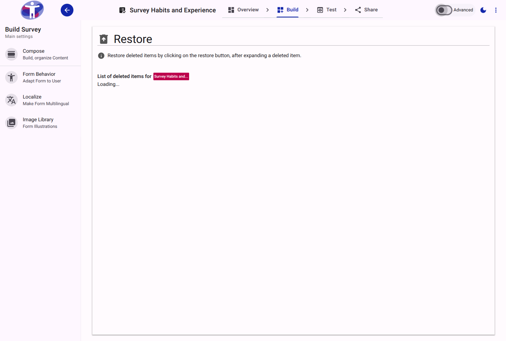
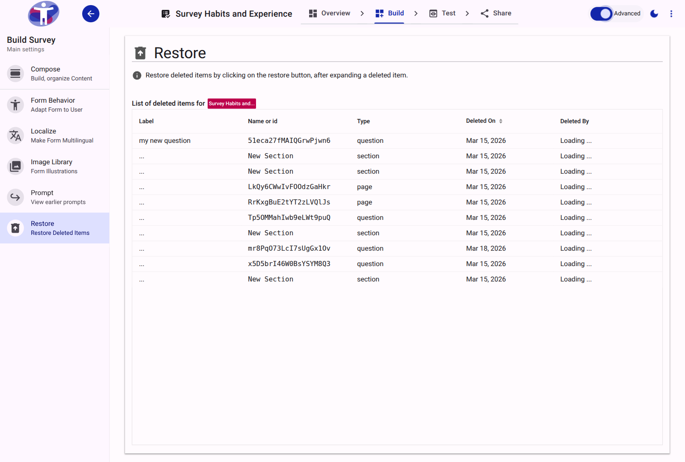

# Restore Reference

The **Restore** tool (`app-survey-build-restore`) provides a recovery workspace for retrieving survey elements — questions, sections, pages, logical expressions, and survey text items — that were deleted during editing sessions.

<figure>
  
  <figcaption>The Restore Deleted Items grid displaying deleted form components and survey texts.</figcaption>
</figure>

## Soft-Deletion Architecture

Item deletion in Accessible Surveys is **soft and non-destructive**. When an author deletes an item in the editor:

1. The item is not permanently erased from the Firestore database.
2. The item's metadata is updated with `metaData.deleted: true`.
3. An auditable deletion record is written to `metaData.deletion`:
   - `timestamp`: The ISO 8601 date and time when the deletion occurred.
   - `uid`: The authenticated user ID of the editor who deleted the item.
   - `from`: The Firestore path of the parent container that formerly held the item.
4. The item is spliced out of the active parent `items` array, removing it from the builder tree, test previews, and published runtime bundles.

## Storage Scopes

The Restore workspace queries two separate database collections to list recoverable components:

| Scope | Firestore Path | Recoverable Elements |
| :--- | :--- | :--- |
| **Form Items** | `app/data/form/{formId}/items` | Questions, Sections, Pages, Options, and Form Logic Expressions. |
| **Survey Texts** | `app/data/survey/{surveyId}/items` | Survey-level text variants (Introduction, Terms & Conditions, Pre-Submit, and Thank You pages). |

## Restore Table Grid Columns

The Restore interface presents deleted items in a structured data grid (`vaadin-grid`):

| Column Header | Field Path | Rendering & Behavior |
| :--- | :--- | :--- |
| **Label / Name** | `name` / `locale/{lang}/label` | Displays the item's readable title. For questions and sections, it reads the primary language label via real-time data binding. For logic expressions, it displays the expression code. |
| **Type** | `metaData.type` | Identifies the component type (`question`, `section`, `page`, `expression`, `text`, or `glossary`). |
| **Deleted On** | `metaData.deletion.timestamp` | Formatted date and time indicating when deletion took place. Click the column header to sort ascending or descending. |
| **Deleted By** | `metaData.deletion.uid` | Renders the team member's full name and avatar (`lapp-user-name`) who initiated the deletion. |

<figure>
  
  <figcaption>The Advanced view of the Restore tool displaying deletion timestamps and user attribution.</figcaption>
</figure>

## Restoration Lifecycle

To restore a deleted element:

1. Navigate to **Build → Restore** in the survey editor.
2. Locate the item in the Form Items or Survey Texts grid using sorting or scrolling.
3. Click on the row to expand its details.
4. Click the **Restore** button (`restore` action).
5. The system performs the following recovery operations:
   - Sets `metaData.deleted: false` on the document.
   - Slices the item reference back into the active parent container's `items` array at its original index (or the end if positions changed).
   - Re-registers any attached translations and accessibility assets.
   - Updates the live Compose tree without requiring a page reload.

::: info Orphaned Item Recovery
If a question or section is restored after its parent Page or Section was also deleted, the restore action safely re-attaches the item to the closest surviving ancestor in the hierarchy.
:::

## Standard vs. Advanced Mode Capabilities

- **Standard Mode:** Focused list prioritizing question and section recovery by label and deletion time.
- **Advanced Mode:** Exposes technical document IDs, Firestore paths, raw data schemas, and allows recovering deleted conditional branching expressions (`metaData.type === 'expression'`).
