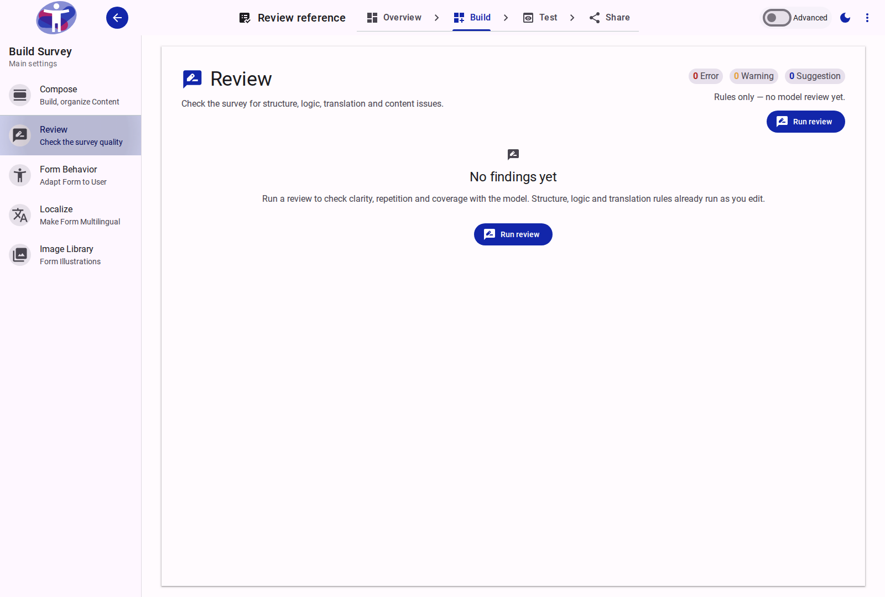

# Review Reference

The **Review** workspace collects the quality findings for a form in one master–detail panel. It combines the deterministic rule checks that run while the author edits with the newest model review run. The panel is the `review` route in the Survey Builder, between **Compose** and **Form Behavior**.

The page is advisory: findings describe a problem and, where a mechanical fix exists, offer the action that applies it. Nothing is changed until the author acts.

<figure>
  
  <figcaption>The Review panel before any model run. Rule checks have found nothing and the run action is available.</figcaption>
</figure>

## Findings

The list combines two sources:

| Source | Produced by | Scope |
| :--- | :--- | :--- |
| **Rule findings** | The structure, logic and translation checks, re-derived from the current form tree as the author edits. | Missing references, invalid logic, empty items, incomplete translations, unpublished shared sections and the survey-level build conditions. |
| **Model findings** | The newest review run, tagged **Model**. | Content quality, repetition and coverage: unclear or leading wording, near-duplicate questions, and topics the survey intent implies but never asks about. |

Model findings are `suggestion` in v1. Rule findings carry `error`, `warning` or `suggestion` according to their check. The header counts every open finding by severity.

<figure>
  
  <figcaption>A selected finding. The detail pane names the item, its stored path, the reason and the available actions.</figcaption>
</figure>

### Finding detail

The detail pane contains:

- the severity and check id;
- the item's label, type and stored path;
- the **Why** evidence;
- a proposed change, when the finding carries one;
- the actions for that finding.

Expression-level findings show the expression text instead of a deep link to the tree.

## Filters and views

The toolbar controls which findings are listed:

- **Open** — findings that have not been dismissed or applied. This is the default.
- **Dismissed** — findings the author hid. The view is read-only until the finding is restored.
- **Applied** — available when at least one finding has been applied; shows its handling state and the Undo affordance where one exists.
- **All / Errors / Warnings / Suggestions** — restricts the list by severity. The header counts are not affected by this filter.
- **By family / By severity** — groups the list by the check family (Structure, Logic, Translation, Content) or by severity.

<figure>
  
  <figcaption>The Errors filter. The list shows only error-severity findings; the severity counts stay visible in the header.</figcaption>
</figure>

Opening the panel from a tree marker applies a **Findings for ⟨item⟩** focus. **Show the whole survey** clears it. If the focused item no longer exists, the panel falls back to the unfiltered list.

## Review runs

::: info
Rule findings are derived in the browser and need no model call. Model findings appear only after a successful review run; the run is served by the review action and, when metering is enabled, consumes one `ai` credit.
:::

**Run review** starts a new review of the current form. A run moves through `running`, `done` and `failed`; the header shows the newest run's age and model.

- A failed run shows its incident message and a **Run again** action.
- A run is **stale** when the form's content hash differs from the hash the run reviewed. The panel shows **Survey changed since this review**; the findings remain visible.
- Re-runs are explicit. Applying a fix does not start a new run.

When review metering is enabled, a run costs one `ai` credit. The header shows **Uses 1 of your N AI credits** and disables the action while the quota is loading, when no quota document exists, or when the balance is zero. Metering is off by default, in which case the panel shows no price.

## Actions

| Finding | Action |
| :--- | :--- |
| Missing translation (`translation.locale`, `translation.easyread`) | **Translate this item** into the missing language, or **Translate all missing into ⟨language⟩** for the family. |
| Logic slot points at a missing expression or has no implementation | **Clear slot**. |
| Shared section is not published | **Activate** the section. |
| Finding carries a field-text proposal | **Apply** writes the proposed text. **Undo** restores the previous value. |
| Finding carries a new-item proposal | **Insert** adds the proposed page, section, question or text. The item still passes through the generated-content review queue. |
| Any finding | **Dismiss** hides it; **Restore** brings it back from the Dismissed view. |

**Open in Compose** jumps to the item's row whenever the item has a tree row. Expression findings instead show the expression text, because there is no item row to edit.

Actions are disabled with a reason when the item is frozen, cannot be read, no longer has the proposed field, or a new item has no valid parent. Translation applies have no undo in v1; inserted items are undone by rejecting them in the generated-content queue.

## Editor markers

In the Compose tree's **settings mode**, a `review-field` column marks items with open findings. The marker uses the highest severity's colour and shows a numeric badge when an item has more than one open finding. Selecting the marker opens the Review panel filtered to that item. Dismissed and applied findings do not produce markers.

The Compose tree header also shows a **findings count chip** while the author is working. It opens the unfiltered Review panel.

## Publish

The share flow renders the same Review panel with the same actions. It also folds in the build's stored warnings, so the author sees the current rule and model findings together with the last build report at the moment they publish.

## Related Content

- [Compose](./compose/index.md) — structure the pages, sections and questions a finding refers to.
- [Form Behavior](./behavior.md) — configure logic and accessibility settings that the rule checks inspect.
- [Localize](./localize.md) — complete the translations reported by the translation checks.
- [Share](../share/index.md) — publish the survey and review the build report alongside the Review panel.
- [Logic Expressions](../content/logic-expression/index.md) — the expression syntax behind the logic checks.
- [Survey Builder Reference](./index.md) — the other Survey Builder workspaces.
