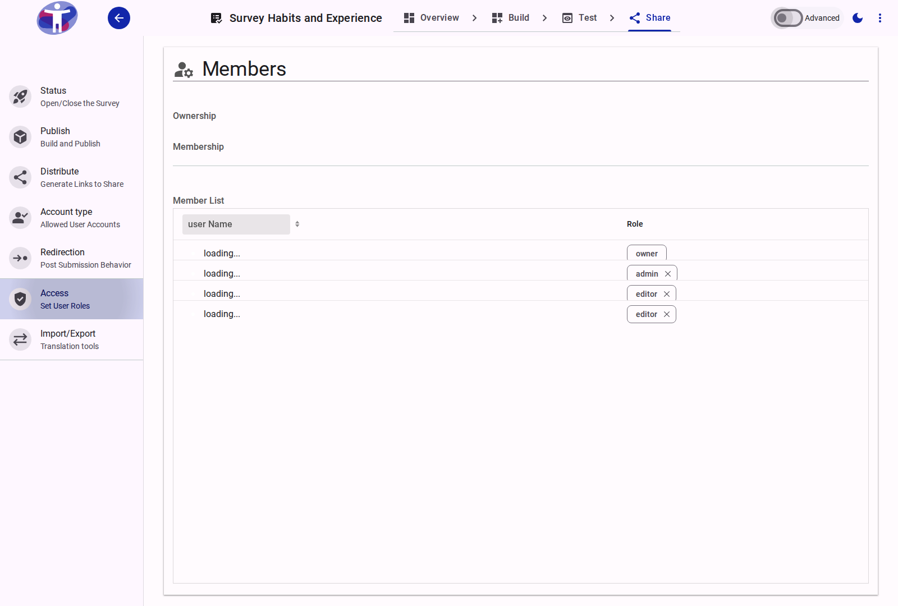
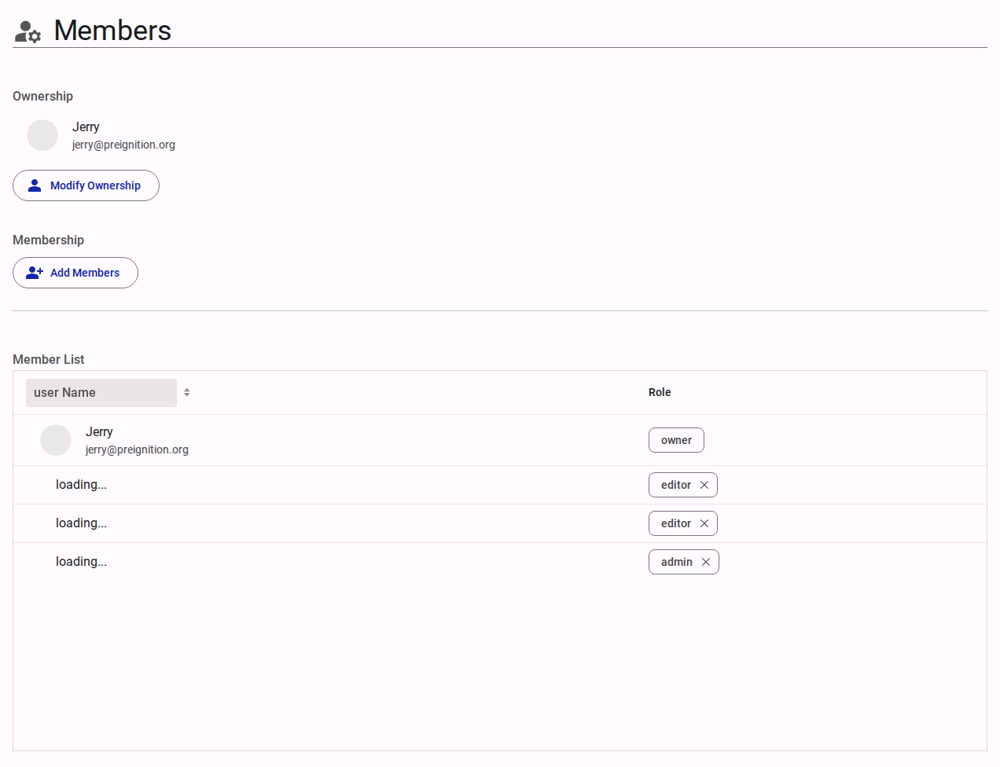

# Survey Access

The **Access** page allows you to govern survey-level permissions, specifying which users are authorized to view, edit, or manage the survey.

<figure>
  
  <figcaption>The survey access settings interface</figcaption>
</figure>

## Interface Overview

<figure>
  
  <figcaption>Access settings content</figcaption>
</figure>

Access rights control which users can manage this specific survey. The user who creates the survey is automatically designated as the **Owner**.

Users can be assigned one of the following roles:

- **Owner**: Full administrative control over the survey, including changing ownership, granting or revoking roles, and deleting the survey.
- **Admin**: Full configuration, publishing, and editing permissions, with ability to manage collaborators.
- **Editor**: Comprehensive editing and configuration rights to build questions, configure settings, and deploy updates, but cannot delete the survey.
- **Guest / Viewer**: Read-only access to inspect the survey structure and view response analytics without editing privileges.
- **Translator**: Targeted permission to translate survey content for a designated language without altering the core questionnaire structure.

To assign rights to a user, they must belong to your organization or team.

## Related Content

- [Access Rights How-to Guide](../../../how-to/access-rights.md) — Step-by-step instructions for adding and updating user roles
- [Authorization and Security Rules](../../../explanation/authorization.md) — Detailed explanation of access policies and client capabilities
- [Customer Portal Members Reference](../../../../customer/reference/customer/members.md) — Managing organization account holders and team members
