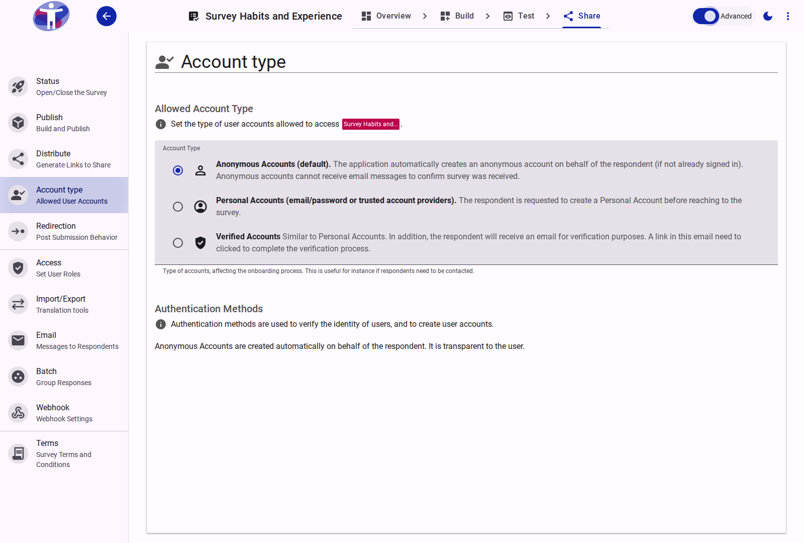

# Advanced Account Settings

In **Advanced Mode**, the Account Type page exposes authentication methods and domain restrictions for surveys requiring Personal or Verified Accounts.

<figure>
  
  <figcaption>Advanced account type settings displaying authentication methods.</figcaption>
</figure>

## Authentication Methods

When your survey is configured for **Personal Accounts** or **Verified Accounts**, enabling **Advanced Mode** reveals the **Authentication Methods** selector:

### 1. Email/Password or Federated Identity Providers (Default)

- **Option code:** `passwordOrFederated`
- **Behavior:** Respondents can create an account using their email address and password, or authenticate with available federated identity providers (such as Google).
- **Use case:** Standard authenticated surveys where respondents can choose their preferred sign-in method.

### 2. Passwordless Email Link

- **Option code:** `emailLink`
- **Behavior:** Respondents enter their email address and receive an email containing a secure sign-in link. Clicking the link authenticates the respondent and confirms their email address in a single step without requiring a password.
- **Use case:** High-convenience authentication that guarantees email verification without password management friction.

## Allowed Domain Restrictions

When **Email Link** authentication is selected, an **Allowed Domain** field becomes available:

- **Pattern:** `@domain.extension` (e.g., `@organization.org` or `@university.edu`)
- **Validation:** Matches against the regex pattern `^@[a-zA-Z0-9]+\.[a-zA-Z0-9]+$`
- **Behavior:** Restricts survey access exclusively to respondents with email addresses under the specified domain. If a respondent submits an email address with a different domain, access is rejected.
- **Leave blank:** Leaving the field empty allows respondents from any email domain to participate.

## Related Content

- [Respondent Account Types](./index.md) — Overview of Anonymous, Personal, and Verified account models
- [Authentication and Identity](../../../explanation/authentication.md) — Conceptual background on respondent accounts and session security
