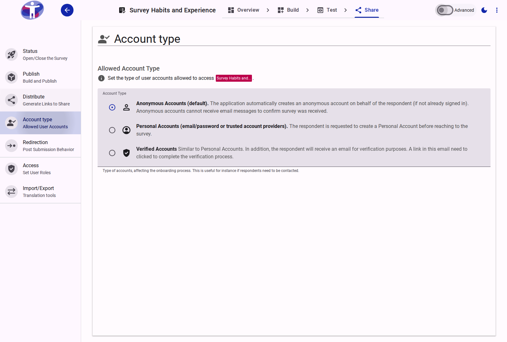
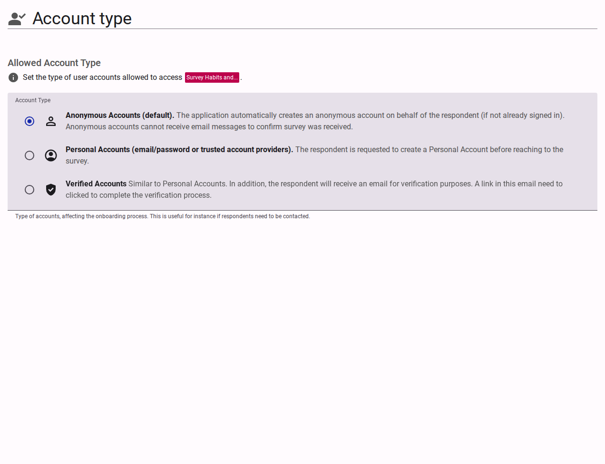

# Respondent Account Types

The **Account Types** page details the authentication requirements for your respondents, dictating how they interact with and access the survey.

<figure>
  
  <figcaption>The survey respondent account types interface</figcaption>
</figure>

## Interface Overview

<figure>
  
  <figcaption>Account type settings content</figcaption>
</figure>

The **Account Types** configuration defines who is eligible to take your survey and how respondent accounts are provisioned:

- **Anonymous Accounts (Default)**: Allows anyone with the link to take the survey. No explicit login is required. The application automatically creates an anonymous session on behalf of the respondent (if not already signed in). Note that anonymous accounts cannot receive survey confirmation emails.
- **Personal Accounts**: Requires respondents to create or log in to a Personal Account prior to accessing the survey (using email/password or federated identity providers such as Google). This associates responses with a persistent user account.
- **Verified Accounts**: Similar to Personal Accounts, but additionally requires respondents to verify their email address. A verification link is emailed to the respondent, and must be clicked to complete the verification process.

::: tip Team Audience Invitations
To restrict participation to specific invited recipients rather than an open link, configure the survey access mode as **Invitation only** under [Share → Distribute](../distribute/index.md#invitations).
:::

## Advanced Settings

In **Advanced Mode**, you can configure authentication methods (email/password vs. passwordless email link) and restrict submissions to specific corporate or educational email domains. See [Advanced Account Settings](./advanced.md).
