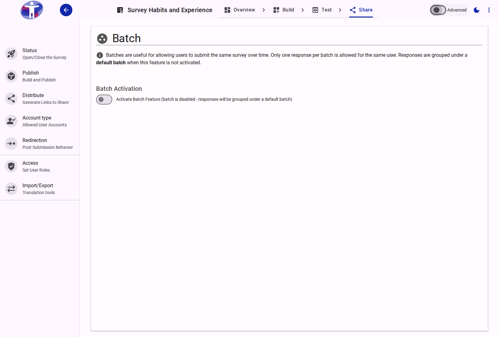
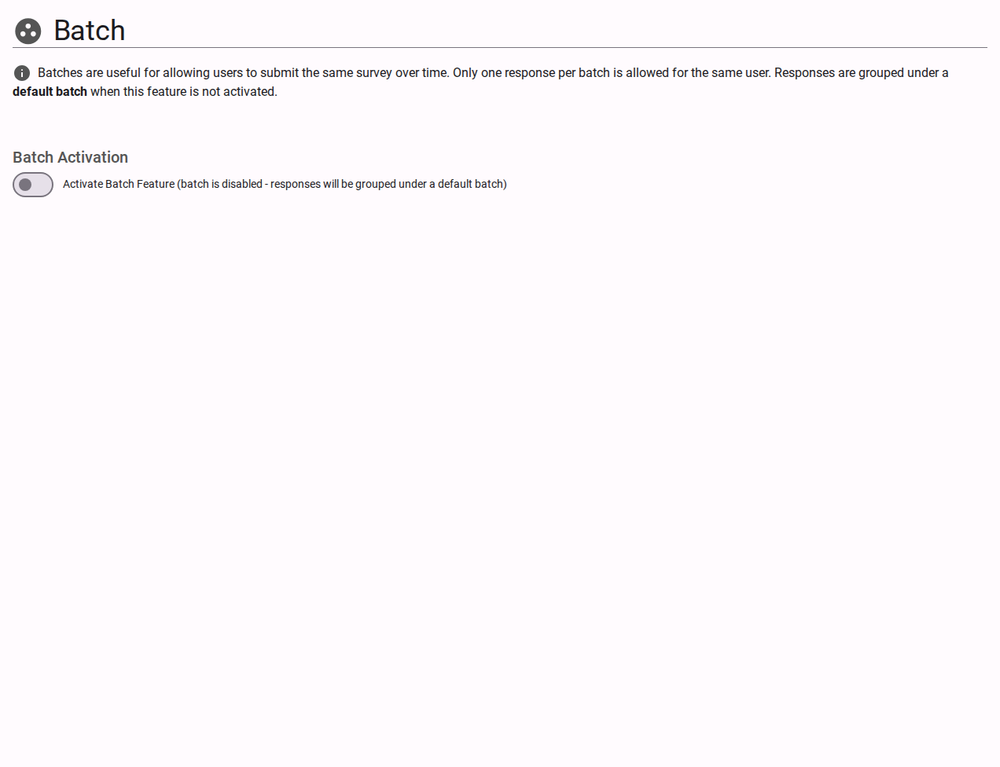

# Survey Batches

The **Batch** page allows you to partition and group incoming survey responses into distinct collection waves, enabling longitudinal studies and periodic re-evaluations.

<figure>
  
  <figcaption>The survey batches interface</figcaption>
</figure>

## Interface Overview

<figure>
  
  <figcaption>Batch settings content</figcaption>
</figure>

By default, all incoming responses are grouped under a single `default` batch. When the batch feature is activated, respondents can submit responses once per batch, allowing you to run recurring waves (e.g., quarterly satisfaction or yearly audits) without creating duplicate surveys.

### Batch Activation

- **Activate Batch Feature Switch (`useBatch`)**: Enables batch partitioning. When disabled, all new responses continue under the default batch.

### Current Batch

When batches are enabled, the page displays which batch is currently receiving new responses:

- **Active Batch Indicator**: Highlights the currently active batch name and description. In the batch table, a star icon marks the active batch row.
- All new incoming responses submitted by respondents are tagged with this active batch ID.

### Batch List and Management

A master grid lists all configured batches for the survey:

- **Add Batch**: Opens a dialog to create a new batch by providing a **Name** and an optional **Description** (e.g., "Q1 2026 Assessment").
- **Make Current**: Set an existing batch as the active batch for upcoming submissions.
- **Analytics Filtering**: In the [Analyze](../../analyze/survey.md) workbench, you can filter and isolate results by batch to compare how responses evolve across different collection periods.

::: tip Scheduling Survey Availability
To schedule exact opening and closing dates for a survey, use [Share → Status](../status/index.md#strategy). Batches group responses into collection waves; opening and closing times are governed by your status schedule.
:::

## Related Content

- [Using Batches How-to Guide](../../../how-to/using-batches.md) — Step-by-step workflow for managing batch waves
- [The Role of Batches Explanation](../../../explanation/the-role-of-batches.md) — Conceptual architecture of batches and response keying
- [Survey Status](../status/index.md) — Schedule automatic opening and closing dates
