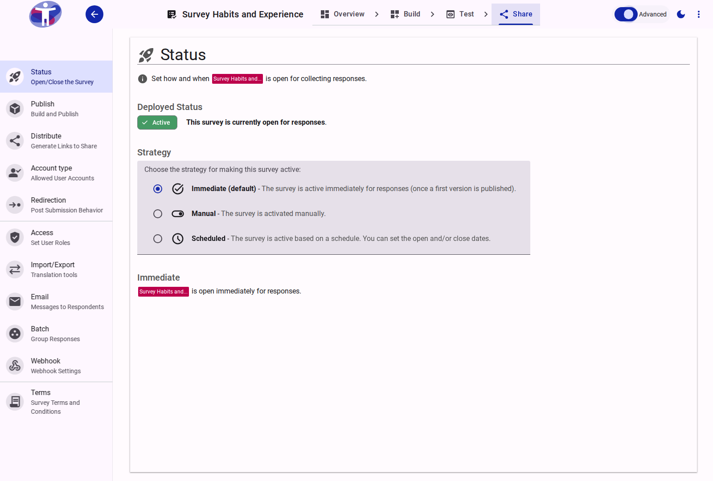

# Behavioral Tracking

The **Behavioral Tracking** page in the **Share** drawer turns on the client-side paradata that powers [Behavioral Analytics](../analyze/behavior.md) and the [behavioral report](../../how-to/behavior-analytics.md). Without it, the Behavior tab has no timing, focus or exit data to analyze.

The page is available in **Advanced Mode** (**Share → Behavioral Tracking**).

<figure>
  
  <figcaption>The Share drawer; Behavioral Tracking appears with the advanced tools.</figcaption>
</figure>

## Settings

### Activate Behavioral Tracking

Collects behavioral events while a respondent completes the survey: page entry and exit, value changes, and status changes. The switch label states whether tracking is currently enabled.

Tracking is off by default. Turning it on affects only sessions that start afterwards; data already collected stays available.

### Monitor Drop Off

Records and analyzes drop-off for stale sessions, so the Behavior tab can report where respondents stopped rather than only who submitted.

Monitoring **requires** behavioral tracking. The two switches keep themselves consistent:

| Action | Result |
| --- | --- |
| Turn **Monitor Drop Off** on | **Activate Behavioral Tracking** turns on as well. |
| Turn **Activate Behavioral Tracking** off | **Monitor Drop Off** turns off as well. |
| Turn **Monitor Drop Off** off | Tracking stays as it is. |

This is enforced on write, not only in the interface, so the saved survey cannot hold drop-off monitoring without tracking.

## What is recorded

Behavioral tracking is non-invasive. It records events and timings, not content or keystrokes:

- time spent actively interacting with each question, and idle time when the tab is unfocused or untouched;
- tab focus changes;
- answer revisions (choice edits);
- paste and high-velocity text entry;
- the last page and question reached, for drop-off analysis.

It does not log keystrokes, record the screen, capture biometrics, or store answer text as part of the behavioral records. The derived metrics, thresholds and quality flags are documented in the [Behavioral Analytics reference](../analyze/behavior.md).

## Plan availability

Behavioral tracking is available on some plans only. When the page reports that it is unavailable for the current plan, the Behavior tab still opens but has no tracked sessions to summarize.

## Checklist before analyzing behavior

1. Open **Share → Behavioral Tracking** in Advanced Mode.
2. Turn on **Activate Behavioral Tracking**.
3. If you need abandonment analysis, turn on **Monitor Drop Off** as well.
4. Publish the survey so the setting reaches the respondent runtime.
5. Collect responses, then open **Analyze → Behavior**.

## Related Content

- [How to Analyze Respondent Behavior and Data Quality](../../how-to/behavior-analytics.md): Reading the dashboard and removing low-quality responses.
- [Behavioral Analytics Reference](../analyze/behavior.md): Paradata fields, Confidence Index rubric, quality signals and exclusion taxonomy.
- [Understanding Respondent Behavior and Data Quality](../../explanation/confidence-index.md): Why client-side paradata is used and what it can and cannot show.
- [Status](./status/index.md): Opening and closing the survey that tracking applies to.
