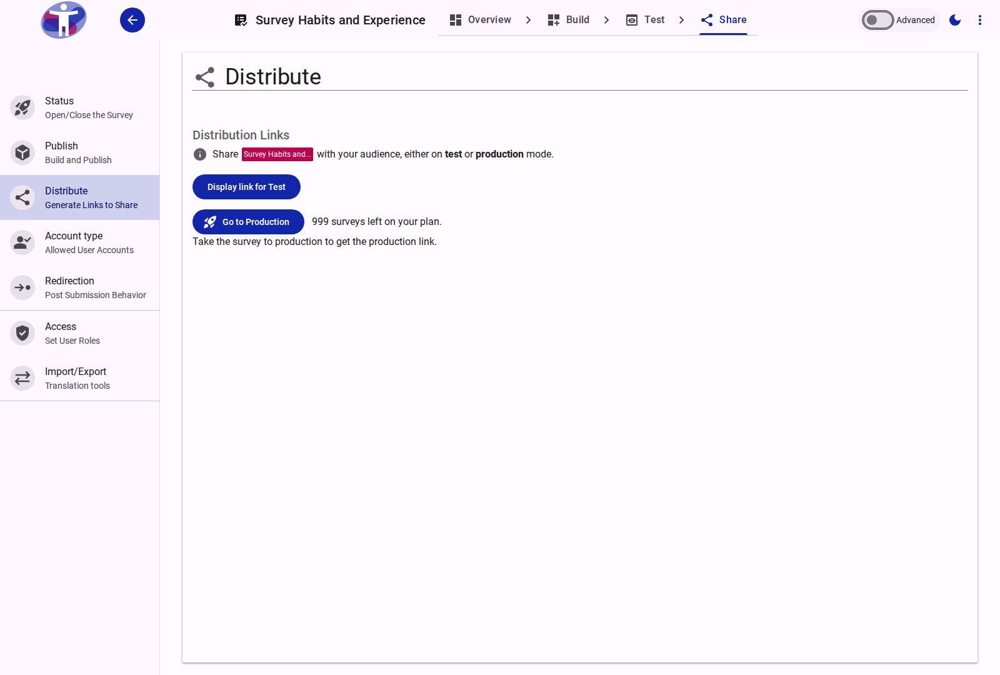
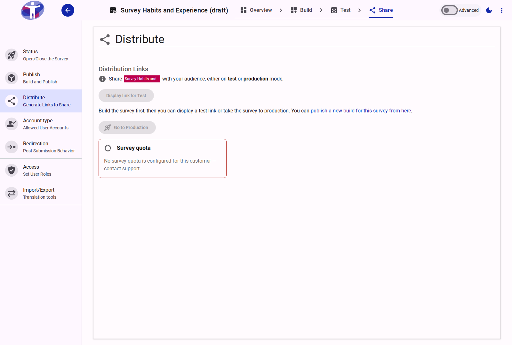
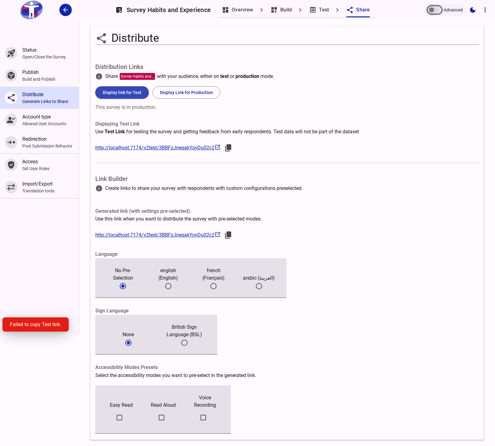
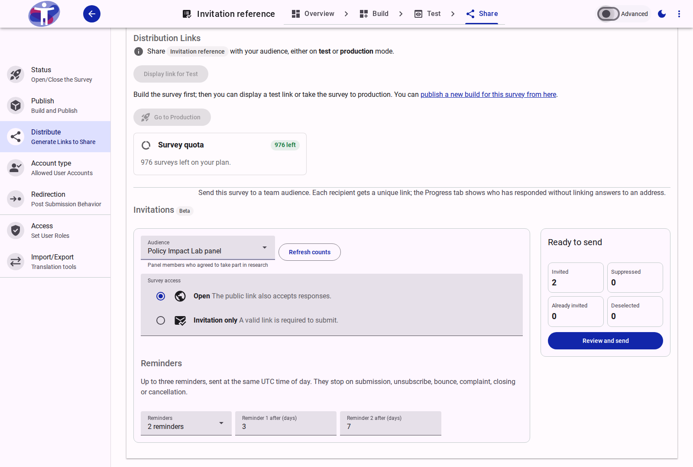
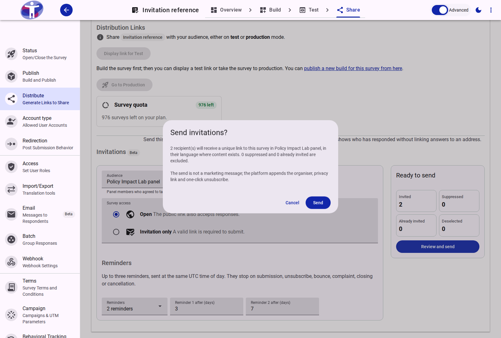

# Distribute Your Survey

The **Distribute** page provides the tools and settings necessary to generate, customize, and copy access links for your survey.

<figure>
  
  <figcaption>The survey distribution interface</figcaption>
</figure>

## Distribution Links

The core of the Distribute page lets you generate access links for different phases of your survey lifecycle:

- **Display Link for Test**: Generates a test URL (using `SURVEY_TEST_URL`). This button stays inactive until the survey has at least one build. Test links are intended for previewing, testing, and gathering feedback from early respondents. Answers submitted via test links are **not** saved to the production database.
- **Go to Production**: Reveals the production link, marks the survey as in production, and redeems one survey from your plan's quota. The button is only enabled once at least one build has been published, and it disappears once the survey is in production.
- **Display Link for Production**: Generates the live production URL (using `SURVEY_PROD_URL`). This button appears once the survey has been taken to production. Submissions via this link are recorded as official production dataset responses.

::: tip
Build the survey first. Until a build exists, the test link is inactive and **Go to Production** is disabled; the page links you to [Publish](../publish/index.md) so you can create one. See [Publishing a Survey](../../../how-to/publishing-a-survey.md) for the full flow.
:::

<figure>
  
  <figcaption>The test link stays inactive and Go to Production is disabled until the survey is built.</figcaption>
</figure>

<figure>
  
  <figcaption>The Link Builder interface with generated test link details</figcaption>
</figure>

## Go to Production and Survey Quota

Building a survey does not make it live. The production link stays hidden until you press **Go to Production** and confirm the dialog, which states what the press costs (for example, *"redeems one of the 5 surveys left on your plan"*). That single action:

- stamps the survey as in production (it cannot be undone), and
- redeems **one survey** from the customer's plan quota.

Below the button, a **Survey quota** card shows the surveys left on the plan (for example, *"25 left"*) and how much of the plan has been used (for example, *"5 of 30 surveys used."*). The card is shown while the survey is not yet in production; once it is, the quota is shown on the **Status** page instead. If no survey quota is configured for the customer, the card asks you to contact support.

Quota gates publishing, not the surveys already live:

- Publishing the last survey on the plan (one unit left) is normal: the plan covers it, no grace window opens.
- Publishing when no unit is left takes the plan to one survey over quota and starts a **10-day grace window**. The confirmation dialog says so before you confirm. Only **this** survey is affected — the other production surveys keep serving respondents.
- The grace deadline is shown on this survey's **Distribute** page. Pay for the additional survey or upgrade the plan before the deadline; afterwards this survey stops accepting responses until quota is added. Buying quota (or the plan renewing) reopens it.
- While the plan is over quota, no further survey can be taken to production.

## The Link Builder

Once you click to display either a test or production link, the **Link Builder** is displayed below. The Link Builder dynamically appends query parameters to your survey URL based on the presets you select:

### 1. Language Presets
If your survey is multilingual and has translations configured, you can pre-select a language for the generated link.

- **No Pre-Selection**: The survey will default to the respondent's preferred browser language.
- **Selected Language**: Appends `?lang=<code>` to force the survey to render in the selected language.

### 2. Sign Language Presets
If sign language modes are active for the survey, you can pre-select a specific sign language dialect.

- Appends `?signlanguage=<code>` to automatically activate the sign language video overlay upon landing.

### 3. Accessibility Modes Presets
Pre-select accessibility modes to be automatically enabled when a respondent opens the link:

- **Easy Read**: Appends `?easyread=true` to render the simplified language version.
- **Read Aloud**: Appends `?readaloud=true` to automatically activate text-to-speech reading.
- **Voice Recording**: Appends `?voice=true` to enable voice response recording features.

Multiple accessibility modes can be combined in the same link.

## Invitations

The **Invitations** section (`app-survey-invitation-composer`) at the bottom of the **Distribute** page distributes the survey by email to a reusable [team audience](../../../../customer/reference/team/audiences.md), generating a unique link (`/v2/{surveyId}/i/{token}`) for each recipient.

<figure>
  
  <figcaption>The Invitations composer showing the Audience selector, Survey access radio group, Reminders schedule, and the Ready to send summary panel.</figcaption>
</figure>

### Prerequisites

Before the composer becomes active:

1. **Invitation email content:** The survey's [Email → Invitation](../email/index.md#invitation-and-reminder-emails) tab must have a non-empty subject, body, and the `{{link}}` placeholder in the survey's primary language. Otherwise, the section displays a warning linking to the Email page.
2. **Team audience:** The survey's team must have at least one active audience in **Team Settings → Audiences**.

### Configuration Controls

| Control | Options / Default | Behavior |
| :--- | :--- | :--- |
| **Audience** | Active team audiences | Selects which audience to invite and displays its description and recipient count. Changing the selection triggers a server preview (`previewInvitationRun`). |
| **Refresh counts** | Button | Re-runs the server preview against the currently selected audience. |
| **Survey access** | **Open** *(default)* / **Invitation only** | **Open:** Both invitation links and the public survey link accept submissions. **Invitation only:** Requires a valid invitation token (`/v2/{surveyId}/i/{token}`) to submit. |
| **Reminders** | `No reminders`, `1 reminder`, `2 reminders` *(default)*, `3 reminders` | Number of automated reminders to send to recipients who have not yet submitted. |
| **Reminder N after (days)** | Default `3` and `7` days | Calendar days after the previous send (initial invitation for Reminder 1; previous reminder for Reminder 2 and 3), dispatched at the same UTC time of day. |

::: info Participation Gate vs. Content Secrecy
**Invitation only** gates survey submission to holders of a valid invitation link, but the published survey build itself remains public. Opening the public URL on an invitation-only survey informs the visitor that an invitation is required.
:::

### Ready to Send Summary and Exclusions

The **Ready to send** panel displays the server-computed dry-run breakdown for the selected audience:

- **Invited (`eligible`):** Active recipients in the audience who will receive an invitation in this run.
- **Suppressed (`suppressed`):** Recipients on the customer-wide suppression list (prior unsubscribe, spam complaint, or hard bounce) — automatically excluded.
- **Already invited (`alreadyInvited`):** Recipients who have already been invited to this survey in an active (non-cancelled) run — automatically excluded so re-sending to an updated audience only invites new members.
- **Deselected (`excluded`):** Recipients excluded from the run.

If any eligible recipients have a preferred language for which no translation exists on the **Email → Invitation** tab, a warning banner notes how many recipients will fall back to the survey's primary language.

### Review and Send Dialog

Clicking **Review and send** opens the **Send invitations?** confirmation dialog summarizing the exact number of recipients to be emailed, the audience name, the excluded suppressed and already-invited counts, and the mandatory platform footer notice.

<figure>
  
  <figcaption>The confirmation dialog shown before creating and sending an invitation run.</figcaption>
</figure>

Confirming with **Send** executes two server actions in sequence:

1. `createInvitationRun`: Freezes the eligible recipient set into a new run document (`app/data/survey/{surveyId}/invitationRun/{runId}`), generates unique tokens, and sets the access mode and reminder schedule. Later edits to the team audience do not affect the frozen run.
2. `sendInvitationRun`: Dispatches the initial batch of emails (up to the 20,000 emails/day team limit; any remainder is deferred and can be sent from Progress) and redirects to [Analytics → Progress](../../analyze/progress.md).

## Related Content

- [How to Send Invitations to a Team Audience](../../../how-to/send-invitations.md) — End-to-end guide from audience import to progress tracking
- [Email Configuration](../email/index.md) — Writing invitation and reminder emails and sending test previews
- [Invitation Progress](../../analyze/progress.md) — Monitoring the invitation funnel, recipient statuses, and reminders
- [Team Audiences](../../../../customer/reference/team/audiences.md) — Managing reusable team recipient lists
- [Campaigns & UTM Tracking](../campaign/index.md) — Creating and managing marketing campaigns
- [Advanced Distribution Settings](./advanced.md) — Custom tracking links and campaign selector in Advanced Mode
- [Publishing a Survey](../../../how-to/publishing-a-survey.md) — Step-by-step guide to building and sharing versions
