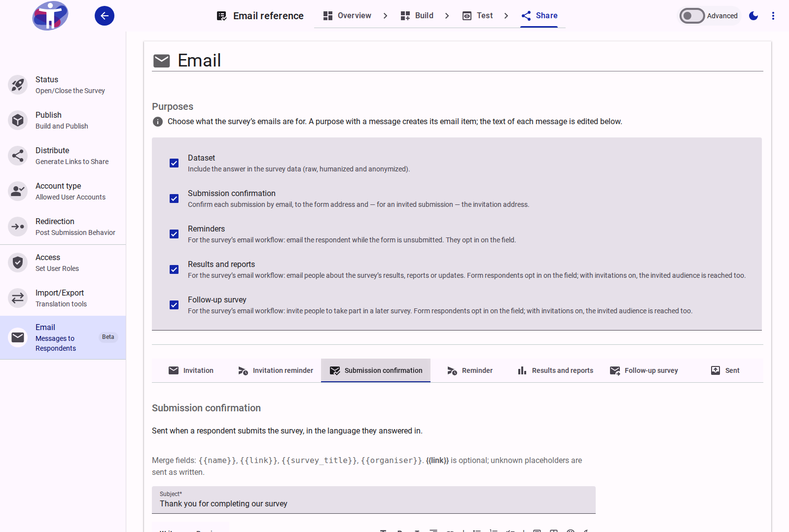
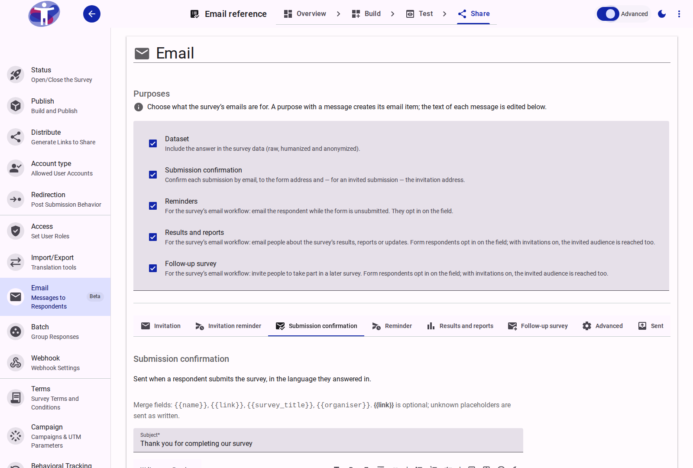
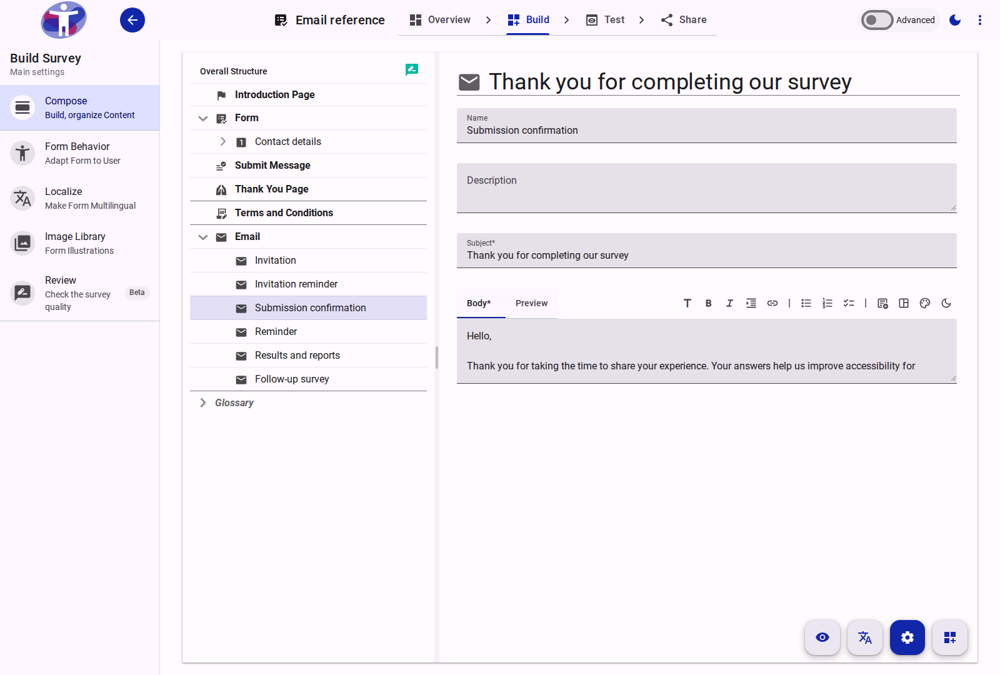
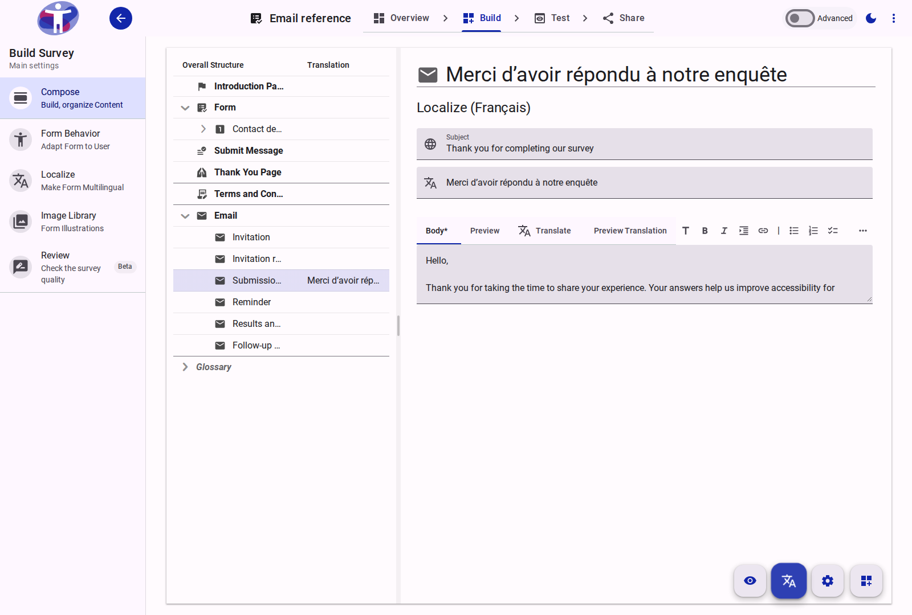
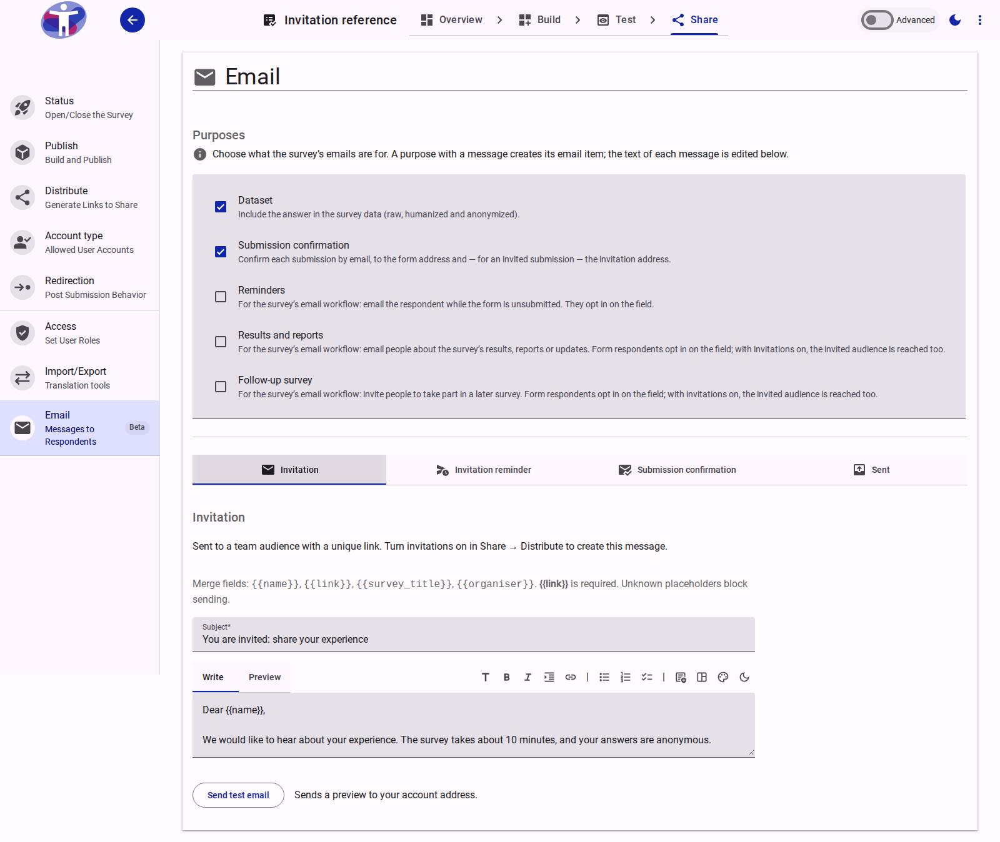
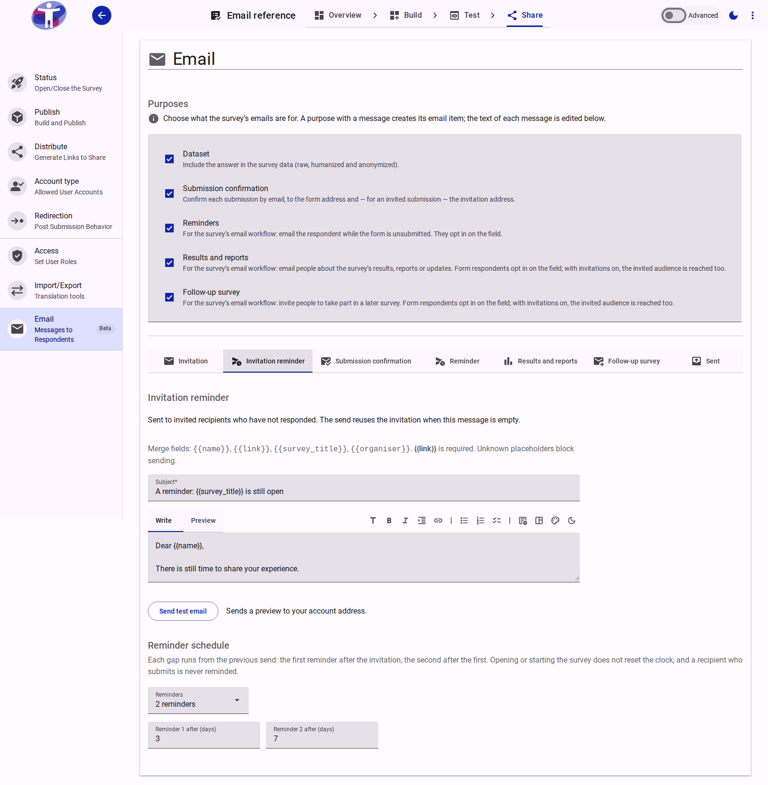
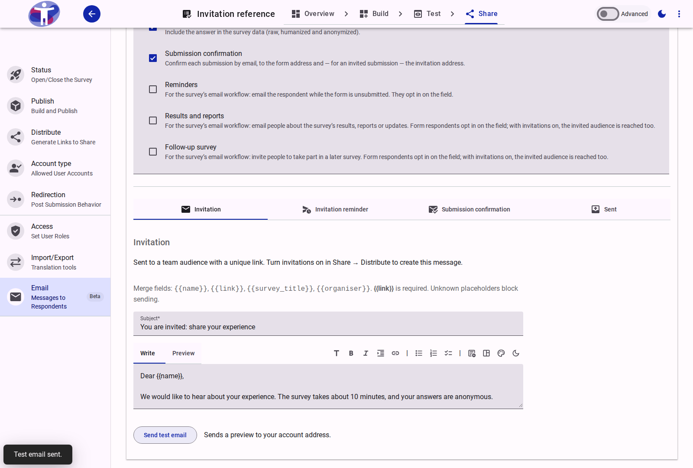
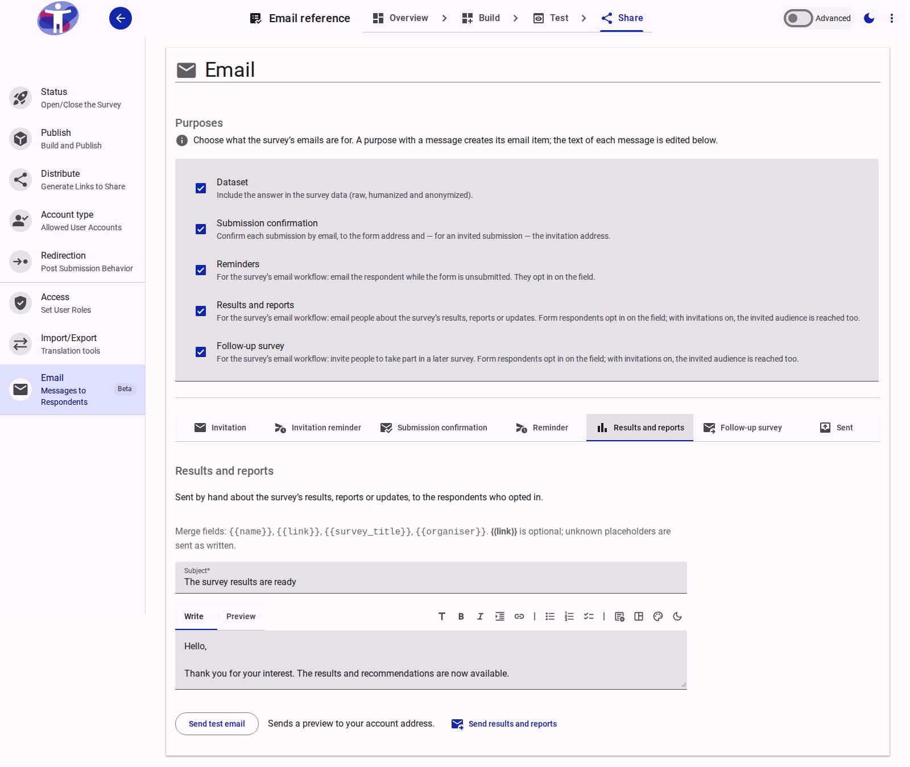

# Email

The **Email** page configures the emails a survey sends to its respondents: the **invitation** and **invitation reminder** emails sent to a team audience, the **submission confirmation**, the opt-in **reminders** for unsubmitted forms, and the **follow-up** emails (**results and reports** and **follow-up survey**) you send by hand once the data has been analysed — their content, the schedules reminders follow, and how long a consent is kept. It is a configuration page: no recipient list is imported or managed here, and no invitation run is launched from it (only a single preview test email to the signed-in editor, or a hand-triggered follow-up send).

The page has two independent channels. The **form channel** is an **Email** or **Account Email** field in the builder; the **invitation channel** is the editor's opt-in on [Share → Distribute](../distribute/index.md#invitations). The form channel's purposes are available without invitations. Turning on invitations creates the **Invitation** and **Invitation reminder** messages; ticking a purpose with a message under **Purposes** creates that purpose's message item.

<figure>
  
  <figcaption>The Email page showing the Purposes picker and the Submission confirmation tab.</figcaption>
</figure>

## Email Tabs and Items

The page is organized into message and configuration tabs:

| Tab | Item Identifier | Delivery Channel | Trigger / Cadence | Merge Fields | Send Test |
| :--- | :--- | :--- | :--- | :--- | :--- |
| **Invitation** | `email-invitation` | Team Audience | Launched from Distribute | `{{link}}` (required), `{{name}}`, `{{survey_title}}`, `{{organiser}}` | Yes |
| **Invitation reminder** | `email-invitationReminder` | Team Audience | Automated schedule or manual send | Same as Invitation | Yes |
| **Submission confirmation** | `email-confirmation` | Form Field / Invitation | Automatic upon submission | `{{link}}`, `{{name}}`, `{{survey_title}}`, `{{organiser}}` | Yes |
| **Reminder** | `email-reminder` | Form Field (opt-in) | Hourly automated schedule | Same as Confirmation (`{{link}}` optional) | Yes |
| **Results and reports** | `email-results` | Form opt-in & Audience | Manual one-off send | Same as Confirmation (`{{link}}` optional) | Yes |
| **Follow-up survey** | `email-followUpSurvey` | Form opt-in & Audience | Manual one-off send | Same as Confirmation (`{{link}}` optional) | Yes |
| **Advanced** | Survey settings | Survey-level | Configuration tab (Advanced mode) | N/A | N/A |
| **Sent** | Send log | All sends | Real-time delivery trace table | N/A | N/A |

<figure>
  
  <figcaption>In Advanced mode, the tab bar includes the Advanced settings tab alongside the active message tabs and Sent history.</figcaption>
</figure>

## Email Items in Compose and Localize

Each email message is stored as a survey item (`email-invitation`, `email-invitationReminder`, `email-confirmation`, `email-reminder`, `email-results`, `email-followUpSurvey`) with its subject and body in the item's `locale/{language}` documents.

- On **Share → Email**, each message tab edits the survey's **primary language**.
- In **Build → Compose**, active email items appear in the structure tree below **Terms and Conditions**, grouped under an expandable **Email** row. Selecting an email item in **Settings Mode** lets you edit its internal **Name** and **Description** alongside its primary-language **Subject** and **Body**.
- In **Localize Mode** (in **Build → Compose** or **Build → Localize**), expanding **Email** lets you translate each message's **Subject** and **Body** into every target language side by side with the primary language. The server **Translate** action and JSON translation **Import/Export** include all active email items automatically.

<figure>
  
  <figcaption>Active email items appear under the Email group row in Build → Compose.</figcaption>
</figure>

<figure>
  
  <figcaption>Translating an email item's subject and body in Localize Mode.</figcaption>
</figure>

## Invitation Opt-In

Invitations are opt-in per survey. The **Invitations** section of [Share → Distribute](../distribute/index.md#invitations) shows a **Send email invitations** switch once the survey's team has at least one audience. The switch writes the survey's `email.invitationEnabled` setting and creates or removes the **Invitation** and **Invitation reminder** items:

- **Off:** the **Invitation** and **Invitation reminder** items are removed (soft-deleted) and no audience email is sent. The form channel still works: when the form collects an address, the **Purposes** picker and the purpose tabs it selects remain available, and confirmations, reminders and follow-ups reach form recipients.
- **On, without an Email or Account Email field:** the **Invitation**, **Invitation reminder**, **Advanced** (in Advanced mode) and **Sent** tabs are available, plus any purpose tabs ticked under **Purposes** (such as **Submission confirmation**, which confirms invited submissions at the invitation address).
- **On, with a field:** the **Invitation**, **Invitation reminder**, the selected purpose tabs, **Advanced** (in Advanced mode) and **Sent** are available. Results and follow-ups reach both the form opt-ins and the invited audience.

Turning the switch off stops invitation traffic and audience sends. Soft-deleted email items keep their previous locale content if re-enabled, the form channel is unaffected, and the **Sent** history stays readable.

## Invitation and Invitation Reminder Emails

The **Invitation** and **Invitation reminder** tabs configure the messages sent when you distribute the survey to a [team audience](../../../../customer/reference/team/audiences.md) from [Share → Distribute](../distribute/index.md#invitations).

<figure>
  
  <figcaption>The Invitation tab showing the merge fields summary, subject and body editors, and Send test email action.</figcaption>
</figure>

### Invitation Email

What each invited recipient receives with their unique survey link (`/v2/{surveyId}/i/{token}`):

- **Language:** Each language has its own subject and body, stored in the `email-invitation` item's locale document and translated in **Build → Compose** (**Localize Mode**) or via the **Translate** action. A complete, valid recipient-language invitation is used as-is; a missing, half-written or invalid one falls back to the complete primary invitation, and the send dialog reports how many recipients fall back.
- **Subject:** Plain-text subject line (up to 200 characters).
- **Body:** Markdown-formatted message body with a live **Preview** tab.
- **Links:** A link is delivered exactly as written. The platform disables the mail provider's click tracking, so the recipient receives the invitation URL (`/v2/{surveyId}/i/{token}`) — in the HTML and the plain-text part — instead of a tracking redirect.

### Invitation Merge Fields and Validation

Both the subject and body support the [merge fields](#merge-fields). Validation runs continuously on both the **Invitation** and **Invitation reminder** tabs:

- Missing `{{link}}` displays an error (`The message needs {{link}}.`) and blocks sending an invitation run from **Distribute**.
- Any unrecognised `{{placeholder}}` displays an error (`Unknown placeholder(s): ...`) and blocks sending.

### Invitation Reminder Email and Schedule

The **Invitation reminder** tab defines the message sent to invited recipients who have not yet submitted, along with the default reminder cadence for new invitation runs:

<figure>
  
  <figcaption>The Invitation reminder tab configures both the optional reminder template and the default invitation reminder schedule.</figcaption>
</figure>

- **Reminder message:** If you provide a custom **Subject** and **Body**, scheduled and manual invitation reminders use that template. If you leave the **Invitation reminder** message empty, the platform automatically reuses the invitation email with a `Reminder N of M:` prefix on the subject line and a `This is reminder N of M from <organiser>.` reason line.
- **Language fallback:** The reminder is picked from the complete, valid recipient-language reminder, then the complete, valid recipient-language invitation, then the complete primary reminder, then the complete primary invitation — never mixing languages.
- **Reminder schedule:** Below the editor, **Reminder schedule** sets how many automated reminders follow the invitation (`No reminders`, `1 reminder`, `2 reminders`, or `3 reminders`) and the delay in days after the previous send (`Reminder 1 after (days)`, `Reminder 2 after (days)`, etc.). Each gap runs from the previous send; opening or starting the survey does not reset the clock, and a recipient who submits is never reminded. The [Distribute composer](../distribute/index.md#configuration-controls) starts from this schedule and writes adjustments back to the survey, while each launched run freezes the schedule it was created with.

### Mandatory Platform Footer and Sender

Every invitation and reminder email automatically appends a mandatory platform footer that cannot be removed:

- **Reason line:** Identifies which team invited the recipient (`<organiser> invited you to take part in this survey.`).
- **Privacy policy link:** Links to the platform privacy notice explaining how invitation records are handled.
- **One-click unsubscribe:** A unique link that records an organization-wide suppression for that address and immediately stops all future invitations and reminders from the customer.

Emails are sent from the platform's domain using the team name as the display name and a team admin's address as the default `Reply-To`. The display name and the survey-level reply-to can be overridden on the **Advanced** tab. For an invitation run, the **Reply-to** selector in the [Distribute composer](../distribute/index.md#configuration-controls) chooses a member of the survey team; leaving it blank uses the team owner's email address.

## Merge Fields

Every message's subject and body support the same placeholders. The invitation is the only message that requires the link; the confirmation, the form reminders and the follow-ups treat it as optional.

| Merge Field | Required | Resolved Value |
| :--- | :--- | :--- |
| `{{link}}` | Invitations only | The recipient's unique invitation URL (`/v2/{surveyId}/i/{token}`) in an invitation or invitation reminder; the survey's public link (`/v2/{surveyId}`) in the confirmation, the form reminders and the follow-ups. |
| `{{name}}` | No | The recipient's name when the platform knows it — the audience record for an invitation, the account name for a submission confirmation; `there` otherwise. |
| `{{survey_title}}` | No | The survey's title. |
| `{{organiser}}` | No | The team's display name; the survey's title when the team has none. |

An invitation or invitation reminder with a missing `{{link}}` or an unknown placeholder is not sent. The confirmation, the form reminders and the follow-ups send without `{{link}}`; an unknown placeholder is left as written.

## Send Test

Every message tab — **Invitation**, **Invitation reminder**, **Submission confirmation**, **Reminder**, **Results and reports**, and **Follow-up survey** — has a **Send test email** button (`sendEmailTest`).

<figure>
  
  <figcaption>Sending a test email preview to the signed-in editor's address.</figcaption>
</figure>

- The recipient address is resolved on the server from the caller's authenticated account, never from the page.
- **Send test email** is disabled until the message has both a subject and a body (`Add a subject and body to send a test.`). An invitation or invitation reminder with a missing `{{link}}` or an unknown placeholder is not sent.
- The preview uses the survey language's content and test merge values: `{{name}}` is `Test` and `{{link}}` is `/v2test/{surveyId}`.
- A test creates no invitation run, consent record, respondent actor or Sent-history row, and does not alter any audience or progress counters.
- When the mail service accepts the preview, the page displays **Test email sent.**

## Email Purposes

The **Purposes** picker at the top of the page sets the survey's email purposes (`email.defaultPurposes`). Purposes belong to the survey rather than individual fields: configuring purposes here or in an [Account Email](../../build/compose/account-email.md) or **Email** field in Build → Compose modifies the same survey-level setting.

| Purpose | Key | Delivery Channels | Respondent Consent | Export Behavior | Description / Item Created |
| :--- | :--- | :--- | :--- | :--- | :--- |
| **Submission confirmation** | `confirmation` | Form field & Invitations | Automatic (transactional) | Excluded unless **Dataset** selected | Sends a confirmation receipt upon survey completion (`email-confirmation`). |
| **Reminders** | `reminder` | Form field only | Explicit opt-in checkbox | Excluded unless **Dataset** selected | Sends automated reminder cadence while form is unsubmitted (`email-reminder`). |
| **Results and reports** | `results` | Form opt-in & Invitations | Explicit opt-in checkbox | Excluded unless **Dataset** selected | Manual one-off email to share findings or reports (`email-results`). |
| **Follow-up survey** | `follow-up-survey` | Form opt-in & Invitations | Explicit opt-in checkbox | Excluded unless **Dataset** selected | Manual one-off email inviting respondents to a future study (`email-followUpSurvey`). |
| **Dataset** | `dataset` | Form field answer | None (standard answer) | Included in `raw`, `humanized`, `anonymized` | Includes collected address in dataset exports as questionnaire data. |

::: info Operational Addresses vs. Dataset
Any purpose other than **Dataset** treats the address as *operational only*: it is stored separately from questionnaire answers and omitted from all data exports (see [Data Privacy and Security](../../../explanation/data-privacy-and-security.md)).
:::

## Submission Confirmation

The confirmation email (`email-confirmation`) is sent automatically when a respondent completes the survey:

- **Trigger Conditions:** Sent if the form collects an address under the **Submission confirmation** purpose, or if the submission originated from an invited team audience link. When both apply, duplicate sends to the same address are automatically prevented.
- **Localization:** Translated per survey language in **Build → Compose** (Localize Mode) or via the **Translate** action; falls back to the primary language confirmation if incomplete.
- **Unsubscribe:** Transactional receipts carry an explanatory notice but omit unsubscribe links. Test submissions never trigger emails.

## Reminders

The reminder email (`email-reminder`) reaches respondents who started the survey but have not yet submitted:

- **Opt-In Requirement:** An email field with the **Reminders** purpose displays an explicit opt-in checkbox and legal notice. Nothing is recorded or scheduled unless the respondent ticks the box.
- **Storage & Privacy:** Stored as an operational session consent (`RespondentEmail`) with the agreed notice version; never visible to editors or included in exports.
- **Unsubscribe & Cadence:** Each reminder includes a one-click unsubscribe link. The hourly reminder cadence is managed under **Advanced Settings**.

## Follow-up Emails

Follow-up emails allow contacting respondents after data collection and analysis:

<figure>
  
  <figcaption>The Results and reports tab includes both Send test email and the one-off Send results and reports action.</figcaption>
</figure>

- **Configuration:** Write the **Subject** and **Body** on the **Results and reports** (`email-results`) or **Follow-up survey** (`email-followUpSurvey`) tab. An incomplete primary message is never offered as an opt-in to respondents.
- **Audience Scope:** Reaches form respondents who ticked the corresponding opt-in checkbox and, if invitations are active, the survey's invited audience (omitting unsubscribed, bounced, or suppressed recipients).
- **Manual Execution:** Follow-ups are not automated. Click **Send results and reports** or **Send follow-up survey** to review recipient counts and trigger the delivery.

## Sent History

The **Sent** tab lists all survey email delivery actions, newest first. Each row represents a single batch send action (displaying target count, delivered, opened, and bounce/suppression status) rather than exposing individual recipient addresses.

## Advanced Settings

In **Advanced Mode**, the **Advanced** tab configures global email options that span across messages:

| Setting Area | Governed Controls | Default | Reference |
| :--- | :--- | :--- | :--- |
| **Consent Notices** | Custom notice text and opt-in labels for reminders, results, and follow-ups | System defaults | [Notice Wording](./advanced.md#consent-notices-and-opt-in-wording) |
| **Respondent Reminders** | Number of reminders (`None`, `One`, `Two`), delay gaps in days, cut-off deadline | 1 reminder, 3 days | [Reminder Schedule](./advanced.md#respondent-reminders) |
| **Consent Retention** | Expiration period for consent records (`1` to `365` days) | 180 days | [Retention Rules](./advanced.md#consent-retention) |
| **Sender Identity** | Sender display name and survey-level `Reply-To` address | Survey title, Team admin | [Sender Settings](./advanced.md#sender-identity) |

See [Advanced Email Settings](./advanced.md) for full parameter tables and configuration instructions.
