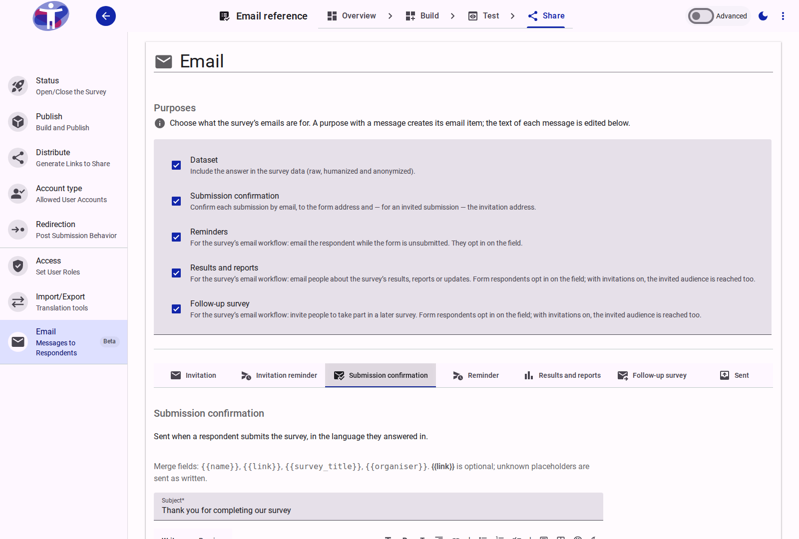
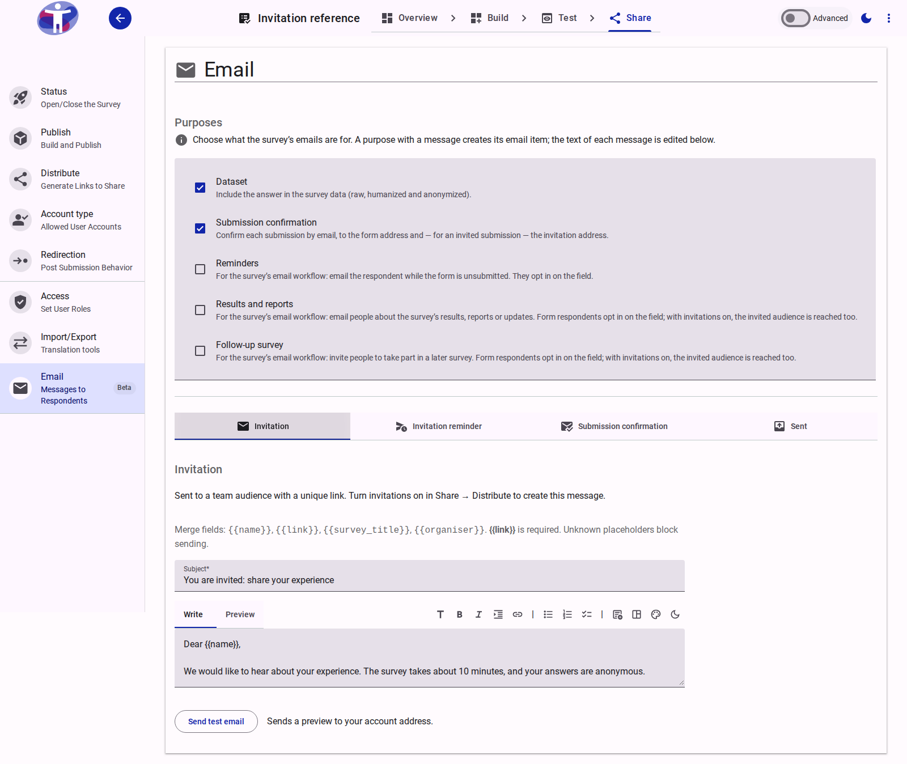
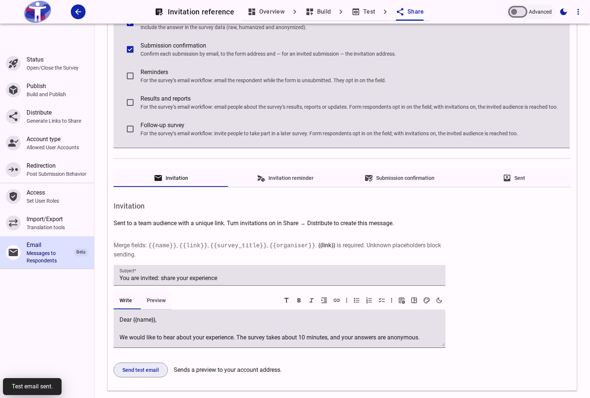

# Email

The **Email** page configures the emails a survey sends to its respondents: the **invitation** and **reminder** emails sent to a team audience, the submission confirmation, the opt-in reminders for unsubmitted forms, and the follow-up emails you send by hand once the data has been analysed — their content, the schedule reminders follow, and how long a consent is kept. It is a configuration page: no recipient list is imported or managed here, and no invitation run is launched from it (only a single preview test email to the signed-in editor).

The page has two independent channels. The **form channel** is an **Email** or **Account Email** field in the builder; the **invitation channel** is the editor's opt-in on [Share → Distribute](../distribute/index.md#invitations). The form channel's purposes are available without invitations. The **Invitation** tab needs the opt-in, and the **Confirmation** tab is always offered with it because an invited submission can be confirmed at the invitation address.

<figure>
  
  <figcaption>The Email page, in advanced mode.</figcaption>
</figure>

The page is organised in tabs: **Purposes** (the survey's email purposes and the two delivery channels), **Invitation** when invitations are on (the email and reminder templates sent when inviting a team audience), **Confirmation** when invitations are on or the form selects it, one tab per remaining form purpose the survey selects — a purpose the survey does not select has nothing to send, so it has no tab — **Advanced** (consent retention, sender and preview), and **Sent** (the delivery history). Each language of the survey has its own subject and body: the **Translations** buttons switch the editor, the active translation is filled, and **Edit primary** returns to the source language. When a translation is active, the primary language is shown read-only above the editor so you can translate from it. The server **Translate** action covers every email message, subject and body.

## Invitation Opt-In

Email is opt-in per survey. The **Invitations** section of [Share → Distribute](../distribute/index.md#invitations) shows a **Send email invitations** switch once the survey's team has at least one audience. The switch writes the survey's `email.invitationEnabled` setting; it is the survey's email master switch.

- **Off:** the **Invitation** tab is hidden and no audience email is sent. The form channel still works: when the form collects an address, the **Purposes** picker and the purpose tabs it selects remain available, and confirmations, reminders and follow-ups reach form recipients.
- **On, without an Email or Account Email field:** the **Invitation**, **Confirmation**, **Advanced** and **Sent** tabs are available. The invitation and its confirmation reach the invited audience.
- **On, with a field:** the **Invitation**, **Confirmation**, the selected form purpose tabs, **Advanced** and **Sent** are available. Results and follow-ups reach both the form opt-ins and the invited audience.

Turning the switch off stops invitation traffic and audience sends. It does not delete content already written, does not stop the form channel, and the **Sent** history stays readable.

## Invitation and Reminder Emails

The **Invitation** tab configures the messages sent when you distribute the survey to a [team audience](../../../../customer/reference/team/audiences.md) from [Share → Distribute](../distribute/index.md#invitations).

<figure>
  
  <figcaption>The Invitation tab showing the language selector, invitation email editor, reminder email editor, and Send test action.</figcaption>
</figure>

### Invitation Email

What each invited recipient receives with their unique survey link (`/v2/{surveyId}/i/{token}`):

- **Language:** Each language has its own subject and body, stored in that language's locale document. Use the **Translations** buttons above the editor; **Edit primary** returns to the source language, shown read-only above the translation. A complete recipient-language invitation is used as-is; a missing or half-written one falls back to the complete primary invitation, and the send dialog reports how many recipients fall back.
- **Subject:** Plain-text subject line (up to 200 characters).
- **Body:** Markdown-formatted message body with a live **Preview** tab.
- **Links:** A link is delivered exactly as written. The platform disables the mail provider's click tracking, so the recipient receives the invitation URL (`/v2/{surveyId}/i/{token}`) — in the HTML and the plain-text part — instead of a tracking redirect.

### Invitation Merge Fields and Validation

Both the subject and body support the [merge fields](#merge-fields). Validation runs continuously on both the invitation and reminder templates:

- Missing `{{link}}` in the invitation email displays an error (`The body needs {{link}}.`) and blocks sending an invitation run from **Distribute**.
- Any unrecognised `{{placeholder}}` displays an error (`Unknown placeholder(s): ...`) and blocks sending.

### Reminder Email (for Invitations)

Below the invitation editor, **Reminder email** defines the message sent to invited recipients who have not yet submitted:

- If you provide a custom **Subject** and **Body**, scheduled and manual invitation reminders use that template.
- If you leave **Reminder email** empty, the platform automatically reuses the invitation email with a `Reminder N of M:` prefix on the subject line and a `This is reminder N of M from <organiser>.` reason line.
- The reminder is picked from the complete recipient-language reminder, then the complete recipient-language invitation, then the complete primary reminder, then the complete primary invitation — never mixing languages.

### Mandatory Platform Footer and Sender

Every invitation and reminder email automatically appends a mandatory platform footer that cannot be removed:

- **Reason line:** Identifies which team invited the recipient (`<organiser> invited you to take part in this survey.`).
- **Privacy policy link:** Links to the platform privacy notice explaining how invitation records are handled.
- **One-click unsubscribe:** A unique link that records an organization-wide suppression for that address and immediately stops all future invitations and reminders from the customer.

Emails are sent from the platform's domain using the team name as the display name and a team admin's address as the default `Reply-To`. The display name and the survey-level reply-to can be overridden on the **Advanced** tab. For an invitation run, the **Reply-to** selector in the [Distribute composer](../distribute/index.md#configuration-controls) chooses a member of the survey team; leaving it blank uses the team owner's email address.

### Send Test

Clicking **Send test** (`sendInvitationTest`) at the bottom of the **Invitation** tab sends a rendered preview of the currently selected language's invitation email to the email address of the signed-in editor.

<figure>
  
  <figcaption>Sending a test invitation to the signed-in editor's address.</figcaption>
</figure>

- The recipient address is resolved on the server from the caller's authenticated account.
- It creates no invitation run, generates no live respondent token, and does not alter any audience or progress counters.

## Merge Fields

Every message's subject and body support the same placeholders. The invitation is the only message that requires the link; the confirmation, the form reminders and the follow-ups treat it as optional.

| Merge Field | Required | Resolved Value |
| :--- | :--- | :--- |
| `{{link}}` | Invitations only | The recipient's unique invitation URL (`/v2/{surveyId}/i/{token}`) in an invitation or invitation reminder; the survey's public link (`/v2/{surveyId}`) in the confirmation, the form reminders and the follow-ups. |
| `{{name}}` | No | The recipient's name when the platform knows it — the audience record for an invitation, the account name for a submission confirmation; `there` otherwise. |
| `{{survey_title}}` | No | The survey's title. |
| `{{organiser}}` | No | The team's display name; the survey's title when the team has none. |

An invitation or invitation reminder with a missing `{{link}}` or an unknown placeholder is not sent. The confirmation, the form reminders and the follow-ups send without `{{link}}`; an unknown placeholder is left as written.

## Email Purposes

The page sets the survey's **purposes**, which decide how collected addresses are used and which message tabs appear. They belong to the survey, not to an individual field — the picker in an email field's settings edits the same setting — and the address itself is collected by an **Email** or **Account Email** field.

The **Purposes** tab states the two delivery channels the purposes serve: **Invitations** (a team audience, managed on Distribute) and **form email fields** (the address a respondent gives). Results and follow-ups use both when invitations are on; confirmations add the invitation address for invited submissions, and reminders remain form-only.

- **Dataset** — the answer is part of the survey data: it appears in the `raw`, `humanized` and `anonymized` exports.
- **Submission confirmation** — the address serves the confirmation email.
- **Reminders** — the address serves the reminder emails; the respondent consents on the field.
- **Results and reports** — the address serves the follow-up email about the survey's results, reports or updates; the respondent consents on the field.
- **Follow-up survey** — the address serves the invitation to a later survey; the respondent consents on the field.

A purpose other than **Dataset** keeps the address out of every export; it is used for the survey's emails only.

The addresses these emails use stay out of the survey's datasets and exports unless the survey also selects **Dataset** — see [Data Privacy and Security](../../../explanation/data-privacy-and-security.md).

## Submission Confirmation

The confirmation email is sent when a respondent submits and the survey has somewhere to send it: the form selects the **Submission confirmation** purpose and collects an address, or invitations are on and the submission came through an invitation. Each survey language has its own **subject** and **body**, edited with the same **Translations** buttons; the respondent receives it in the language they answered in, falling back to the complete primary confirmation. The platform adds a line explaining why the email was sent; it is a transactional one-off, so it carries no unsubscribe link. Test submissions never send email. Both fields support the [merge fields](#merge-fields); unlike an invitation, the confirmation does not require `{{link}}`.

With invitations on, a submission made through an invitation link is confirmed at the invitation address as well: one confirmation goes to the form's confirmation address and one to the invited address, deduplicated when they are the same. This works even when the form has no confirmation-purpose field, because the invitation established the address.

## Reminders

A field that carries the **Reminders** purpose shows the respondent a notice and an **opt-in checkbox**. Nothing is sent unless the respondent ticks it: the platform records their consent — the address, the session it came from and the wording version they agreed to — and may email them while the form is unsubmitted. Ticking the box is the only write; typing, prefilling or leaving the field records nothing, and a test session records nothing.

Consent is per respondent: one record per session, which a later opt-in in the same session updates, and which the field's checkbox reflects when the respondent comes back. Editors never see the addresses — the contact records are not part of the survey data and are never exported.

Each survey language has its own reminder **subject** and **body**. A reminder is sent in the language recorded on the respondent's session — the language they answered in — falling back to the complete primary reminder when that language has none or is half-written. The platform adds a line explaining why the respondent received it, and the public unsubscribe link. The subject and body support the [merge fields](#merge-fields); `{{link}}` is optional.

## Follow-up Emails

After the survey's data has been analysed you may want to write to the respondents again: to share the results or a report, or to invite them to a later survey. Both are follow-ups, and both need a purpose of their own — **Results and reports** and **Follow-up survey**. A field that carries one asks the respondent to opt in, exactly as a reminder field does; a field may carry both, and then shows a checkbox for each.

Writing the email on the purpose's tab is what makes the opt-in possible: a purpose with no complete subject and body in the primary language is not offered to respondents, so a consent is never collected for an email the survey cannot send. Write the **subject** and **body** per survey language — the email is sent in the language the respondent answered in, falling back to the complete primary message. The subject and body support the [merge fields](#merge-fields); `{{link}}` is optional.

Each follow-up has its own **Send** action. It reads the respondents who opted in for that purpose and, when invitations are on, the survey's invited audience; tells you how many will receive the email before you confirm; and sends once you do. The Send button stays disabled until the complete primary subject and body exist. A follow-up is not scheduled and not repeated: pressing Send again emails the same recipients again, so use it for a new message rather than a correction. The platform adds a line explaining why the recipient received it, and the public unsubscribe link; a send that the mail service did not accept is left for the next press of Send, and the dialog reports what went out.

An audience recipient did not opt in through a form field, so their reason line names the invitation instead of the consent, and their unsubscribe link is the invitation's organisation-wide one. An audience member who unsubscribed, bounced, complained or is on the customer-wide suppression list is not emailed.

The email is free text you write — the page does not publish a report or a survey for you. `{{link}}` resolves to the survey's public link; a link to a report page or a later survey is written in the body.

## Reminder Schedule

An hourly job sends the reminders. Each of the survey's reminder fields can name the same **Reminders** purpose, but a respondent consents once per survey, so they receive at most the configured number of reminders for that consent.

- **Reminders** — how many a consent may receive: none, one or two.
- **Delay** — how many days after the last contact a reminder goes out: the first after the respondent's opt-in, the second after the first reminder.
- **Deadline** — no reminder is sent after this day (leave it empty for no deadline).

The job only ever emails a session that has not submitted, whose consent is still active and unexpired, and that belongs to the survey's current batch. Changing the batch therefore stops the reminders of the previous one.

## Consent Retention

A consent is kept for a bounded period — **180 days** by default, adjustable between 1 and 365. When it passes, the platform deletes the record, and with it the address. The respondent's responses and every dataset are untouched: purging the collected data ends the reminders and the follow-ups too.

Every reminder carries an unsubscribe link. It opens a public page in the respondent app — no sign-in — that validates the link's token on the server, withdraws the consent, and confirms in the survey's language. An invalid link, or one that was already used, shows a safe message and changes nothing.

## Sent History

The **Sent** tab lists the survey's send actions, newest first: the message kind (invitation, invitation reminder, reminder, results or follow-up), when it ran, how many recipients it targeted, and how many the mail service accepted, delivered, opened or refused. One row is one action, not one recipient: a 10,000-person invitation run is a single row. An invitation row's delivered and opened counts update as the mail service reports them, so the row shows engagement without leaving the tab; started and submitted counts stay on the run's **Progress** tab, linked from the row. Submission confirmations are transactional and are not listed. The history is a trace, not an address book: it never carries addresses, and a failed history write never changes whether a mail was sent. The table is a live read, so a finished action appears as it is recorded.

## Preview

The preview shows the notices respondents will read and the confirmation email of the primary language. The platform adds the reason line to a confirmation, and the unsubscribe line to a reminder, when an email is sent.

## Advanced Settings

The notice and opt-in wording, and the sender identity, live in the page's advanced sections — see [Advanced Email Settings](./advanced.md).
