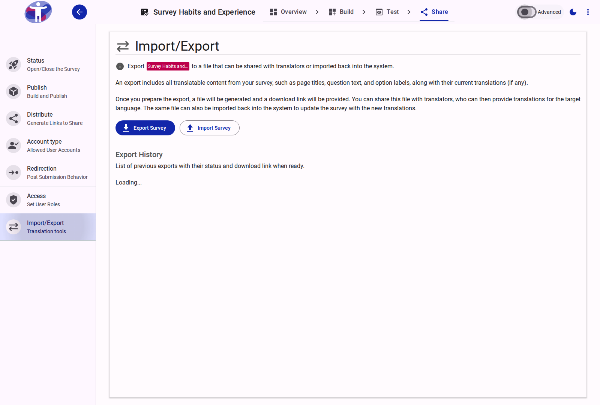
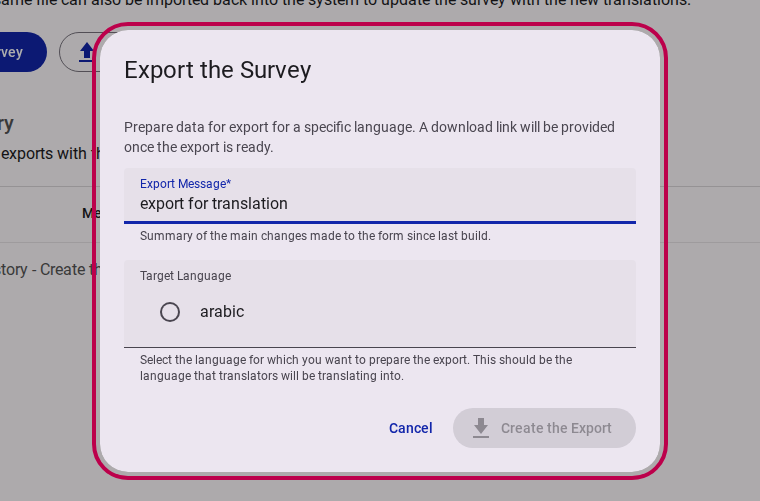
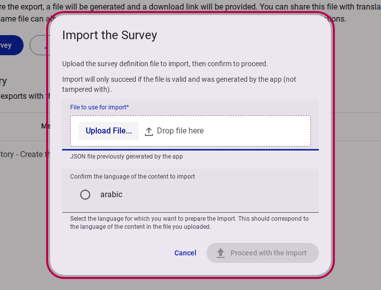
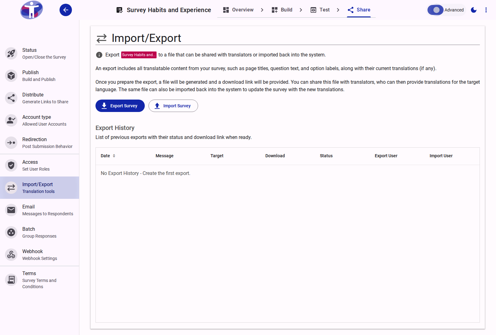

# Import/Export Translations & Media

The **Import/Export** page provides tools to extract translatable survey content and sign-language video configurations into a structured file, share it with external translators or media producers, and re-import it to update the survey.

<figure>
  
  <figcaption>The Import/Export settings interface</figcaption>
</figure>

## Overview

An export file contains all translatable elements of your survey structure:

- Page titles, section descriptions, question labels, supporting text, and choice option labels.
- Existing translations for all configured languages.
- **Sign Language Video IDs**: YouTube video identifiers mapped to questions, choices, and instructions for active sign languages.

This enables an offline localization and media-tagging workflow:

1. Generate an export file targeted for a specific written language or sign language.
2. Share the file with language translators or sign-language video coordinators to input translated text or add video IDs in bulk.
3. Import the completed file back into the survey to update translations and video mappings in a single pass.

## Exporting a Survey

Click **Export Survey** to generate a translation or media package:

<figure>
  
  <figcaption>Export survey dialog</figcaption>
</figure>

When creating an export, provide:

- **Export Message**: A descriptive note recording the purpose of this export (e.g., "Export for Spanish translation and LSF sign-language IDs").
- **Source Language**: The primary language of the survey content.
- **Target Language**: The language that translators will provide content for. You can choose any supported written language (e.g., `es`, `fr`, `ar`) or sign language (e.g., `ase` ASL, `fsl` LSF, `bzs` Brazilian Sign Language).

Once submitted, the export job processes in the background. When ready, a download link for the JSON file appears in the **Export History** table.

## Importing a Survey

To apply translations or sign-language video IDs from a completed file, click **Import Survey**:

<figure>
  
  <figcaption>Import survey dialog</figcaption>
</figure>

::: warning File Integrity
Import will only succeed if the uploaded JSON file was originally generated by the platform for this survey. Files with modified structural hierarchy or missing element identifiers will be rejected to protect survey integrity.
:::

When importing:

- **File to use for import**: Upload the completed JSON file.
- **Language confirmation**: Confirm the target language matching the translated text and video IDs in the file.

## Export History

The **Export History** section lists all previously generated export files for this survey:

<figure>
  
  <figcaption>Export History table displaying date, message, target language, and download links</figcaption>
</figure>

- **Date**: Timestamp when the export was created.
- **Message**: The description recorded when the export was initiated.
- **Target Language**: Shows the language code and localized name (including sign language dialects).
- **Download**: Provides a direct download link (`Download Export`) once background processing completes.
- **Status**: Live status indicator (`processing`, `exported`, `imported`, or `failed`).

## Related Content

- [Using Import/Export to Translate Forms](../../../how-to/import-export.md) — Step-by-step localization workflow
- [Localize Reference](../../build/localize.md) — In-editor localization tools
- [Sign Language How-to Guide](../../../how-to/use-sign-language.md) — Configuring sign-language presentation and video playback
