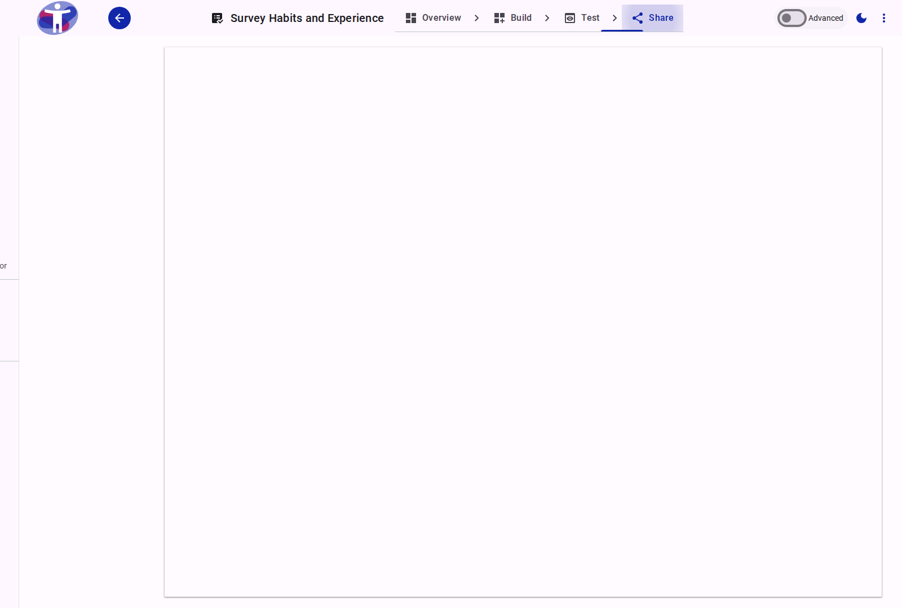

# Sharing Your Survey

This section explains the tools and configuration settings available in the **Share** drawer for publishing, distributing, protecting, and integrating your survey.

<figure>
  
  <figcaption>The survey sharing dashboard.</figcaption>
</figure>

## Interface Overview

The **Share** section is your hub for managing the operational lifecycle of your survey:

- [Status](./status/index.md) — Check if your survey is open or closed, and configure immediate, manual, or scheduled availability.
- [Publish](./publish/index.md) — Compile question definitions into an immutable release build and view build history.
- [Distribute](./distribute/index.md) — Get test and production links, configure language and accessibility presets, monitor survey quota, and send invitations to a team audience.
- [Account Type](./account-type/index.md) — Configure anonymous, personal, or verified respondent account requirements, authentication methods, and domain restrictions.
- [Redirection](./redirection/index.md) — Configure post-submission routing (application homepage, no redirection, or custom URL) and redirect timeouts.
- [Access](./access/index.md) — Manage collaborator roles (Owner, Admin, Editor, Guest, Translator) for this survey.
- [Import/Export](./import-export/index.md) — Export translatable text and sign-language video IDs, and import completed localization packages.
- [Email](./email/index.md) — Configure invitation emails, submission confirmations, opt-in reminders, and follow-up communications.
- [Batch](./batch/index.md) — Group responses into longitudinal collection waves and designate the active batch.
- [Campaign](./campaign/index.md) — Track marketing campaigns and build UTM-tagged distribution links.
- [Webhooks](./webhook/index.md) — Configure real-time HTTP event webhooks with live testing and delivery audit logs.
- [Behavioral Tracking](./behavioral-tracking.md) — Enable client-side paradata for Behavioral Analytics and drop-off monitoring.
- [Terms](./terms/index.md) — Require explicit agreement to custom terms and conditions before respondents begin.
