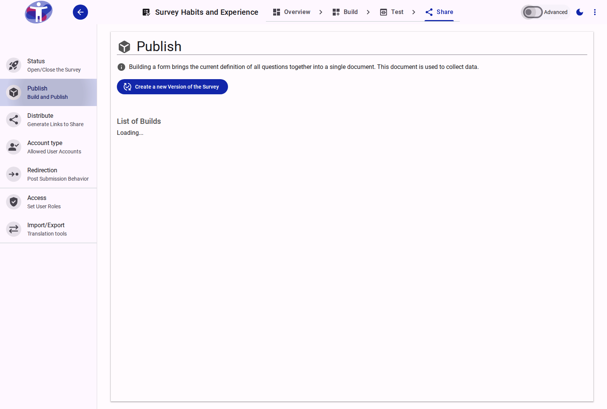
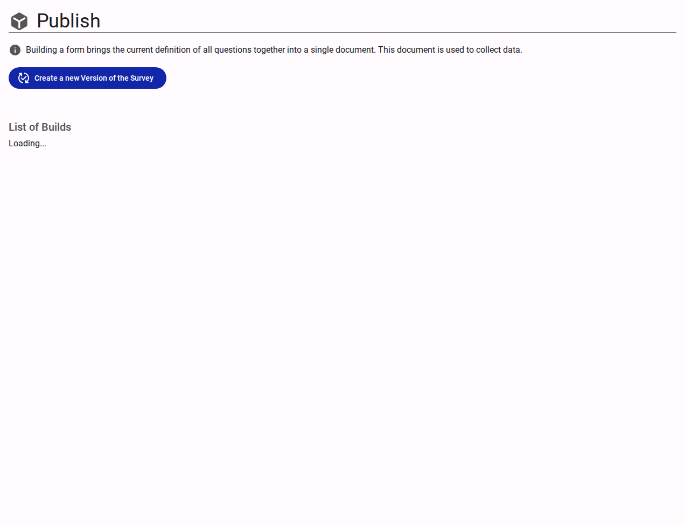

# Publish Your Survey

The **Publish** page allows you to compile your latest survey changes into a production build and review previous build history.

<figure>
  
  <figcaption>The survey publishing interface</figcaption>
</figure>

## Interface Overview

<figure>
  
  <figcaption>Publish settings content</figcaption>
</figure>

Building a survey compiles the current definition of all questions, pages, sections, media assets, translations, and logical rules into a single immutable document that the respondent app consumes to collect data.

### Building Your Survey

- **Build / Publish Action**: Click **Build** to compile the latest changes into a new build.
- **Version Increment**: When triggering a build, select whether the change is a **Patch**, **Minor**, or **Major** release, and optionally provide a descriptive release message.
- **Pre-Publish Warnings**: If your survey has unresolved quality, logic, or accessibility findings (from the Review panel), or missing translations, warnings will be highlighted before you publish so you can address issues before they affect respondents.

### List of Builds

A history grid lists all previous builds created for this survey:

- **Current Build Indicator**: A star icon highlights the build currently served to live respondents (`latestBuild`).
- **Build Version & Date**: Displays the version label and timestamp for each compiled build.
- **Build Message**: Shows the description or notes recorded when the build was compiled.

::: info Pausing or Closing a Survey
To open, schedule, or close a survey for incoming responses, navigate to [Share → Status](../status/index.md). Building compiles survey definitions; opening and closing is governed by your status strategy.
:::

## Related Content

- [Survey Status](../status/index.md) — Open, schedule, or close your survey
- [Distribute Your Survey](../distribute/index.md) — Access live links and QR codes
- [Review Reference](../../build/review.md) — Check for logic, translation, and accessibility issues prior to building
