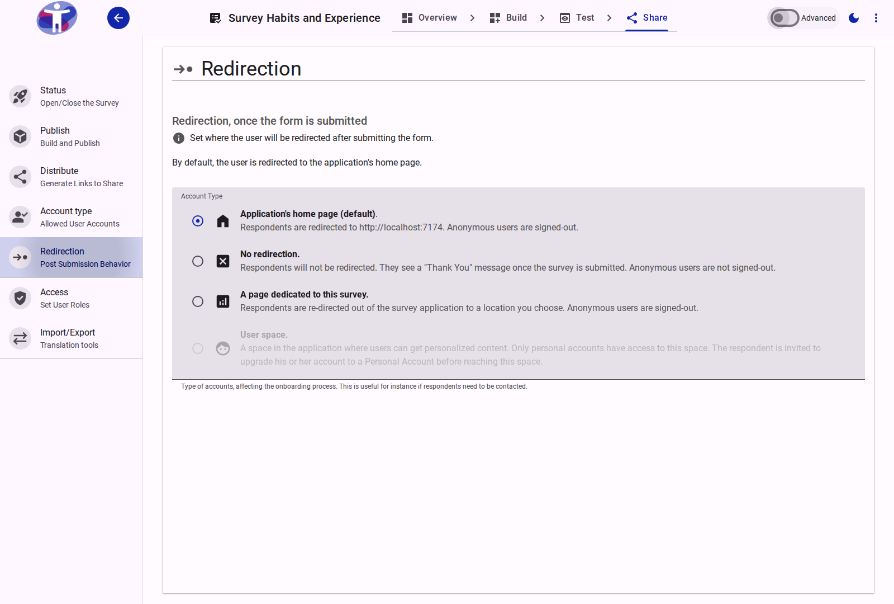
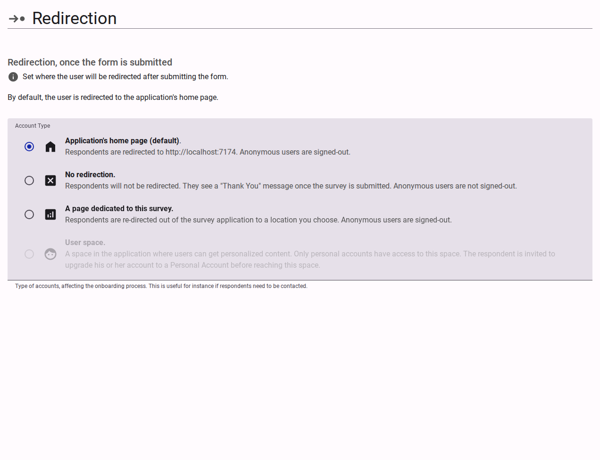

# Survey Redirection

The **Redirection** page determines where respondents are routed immediately after submitting their completed survey.

<figure>
  
  <figcaption>The survey redirection interface</figcaption>
</figure>

## Interface Overview

<figure>
  
  <figcaption>Redirection settings content</figcaption>
</figure>

The **Redirection** configuration governs the post-submission journey:

- **Application's Home Page (`home`, default)**: Respondents are redirected back to the platform's home page (`accessiblesurveys.com`). Anonymous users are automatically signed out.
- **No Redirection (`none`)**: Respondents are not redirected away. They remain on the survey completion screen and see a "Thank You" message. Anonymous users are not signed out.
- **A Page Dedicated to this Survey (`external`)**: Redirects respondents out of the survey application to a custom external web address (e.g., your organization's website or study landing page). When selected, you must enter a valid **Redirect Location** URL (`https://...`).
- **User Space (`userspace`)**: A planned space within the application for personalized respondent summaries. *Note: User Space is currently disabled.*

### Redirect Timeout

When a destination with redirection is selected (**Application's home page** or **A page dedicated to this survey**), you can configure the **Redirect Timeout**:

- **Default:** `8` seconds
- **Behavior:** Specifies how many seconds the confirmation message is displayed before the browser automatically redirects the respondent to the destination URL.

## Related Content

- [Survey Status](../status/index.md) — Open, schedule, or close your survey
- [Distribute Your Survey](../distribute/index.md) — Share links and manage invitations
