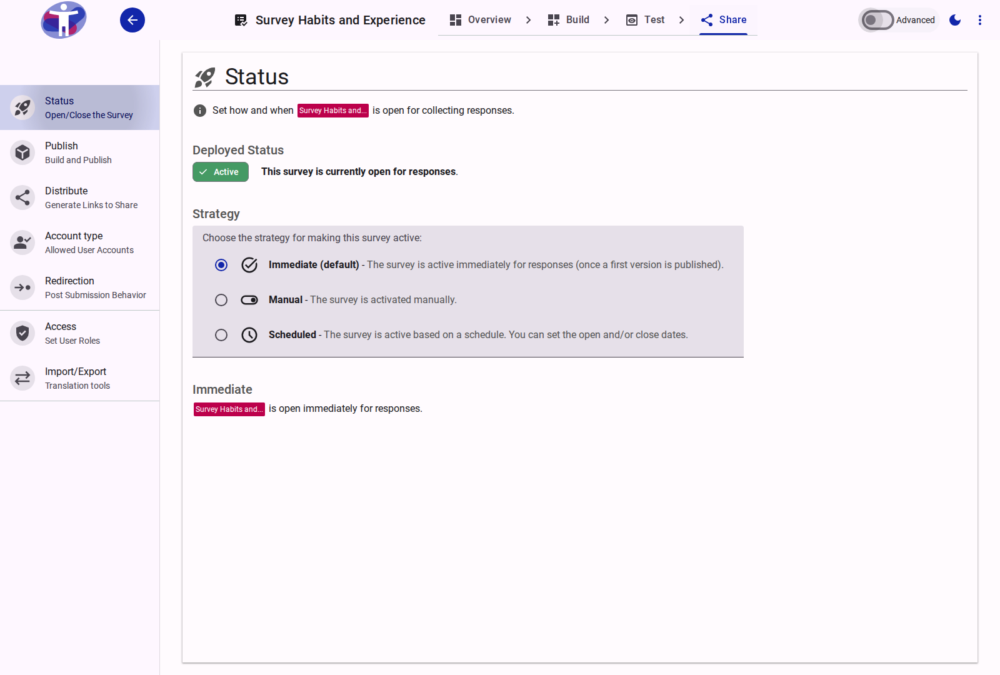
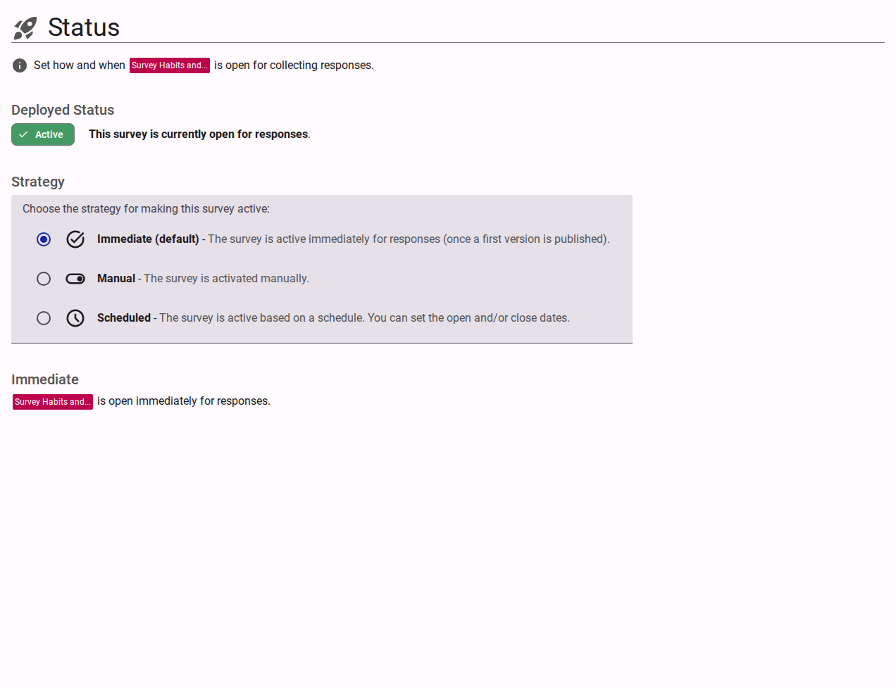

# Survey Status

The **Status** page provides information on the current operational state of your survey and allows you to configure its activation strategy.

<figure>
  
  <figcaption>The survey status page.</figcaption>
</figure>

## Interface Overview

<figure>
  
  <figcaption>Status settings content.</figcaption>
</figure>

The **Status** page allows you to set how and when your survey is open for collecting responses:

- **Deployed Status**: Displays the operational status of the live survey that respondents are accessing right now (e.g., whether it is currently open or closed).
- **Strategy**: Defines the mechanism used to make the survey open for responses:
  - **Immediate (default)**: The survey is open immediately for collecting responses once published.
  - **Manual**: Control availability with an explicit open/close switch.
  - **Scheduled**: Specify an **Open Date** and/or **Close Date** with explicit timezone handling. The survey automatically opens and closes at the designated times.

### Undeployed Changes Notice

Changes to status and availability are saved as you edit. If your new settings differ from the live deployed survey, a warning banner appears:

::: warning Not deployed yet
The new status differs from the status of the deployed survey. Your changes will automatically apply to respondents when you build the survey again.

To apply changes to live respondents immediately without rebuilding the whole survey, click **Apply now to the deployed survey**.
:::

## Related Content

- [Publishing Your Survey](../publish/index.md) — Compile and deploy survey updates
- [Distribute Your Survey](../distribute/index.md) — Access links, QR codes, and survey quota status
