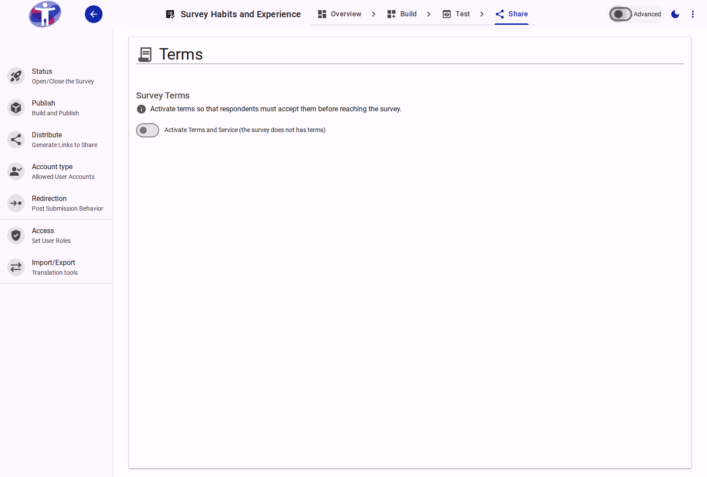
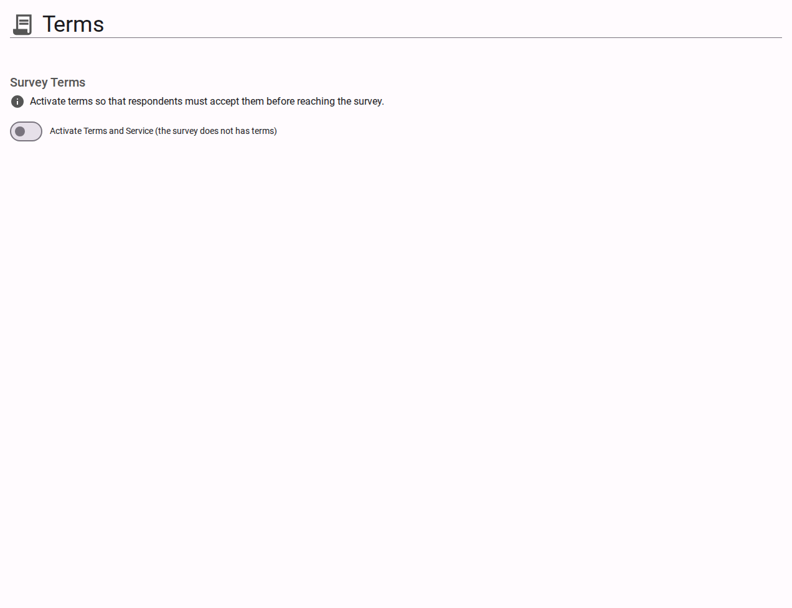

# Survey Terms

The **Terms** page enables you to require respondents to review and accept custom legal terms, consent disclosures, or participant agreements prior to taking your survey.

<figure>
  
  <figcaption>The survey terms and conditions interface</figcaption>
</figure>

## Interface Overview

<figure>
  
  <figcaption>Terms settings content</figcaption>
</figure>

By default, surveys do not require bespoke terms. Activating the **Terms** feature ensures respondents cannot submit data without explicitly agreeing to your terms.

### Activating Terms

- **Activate Terms and Service Switch (`hasTerms`)**: Toggles terms enforcement on or off. When active, respondents must accept terms before proceeding to survey questions.

### Terms Appearance

Choose how terms are presented to the respondent:

- **In a Dialog (`dialog`, default)**: A hyperlink opens a modal dialog displaying the full agreement text. The respondent must review and accept the dialog to proceed.
- **On the page (`embed`)**: The agreement text is displayed directly on the introductory page above the consent checkbox.

### Authoring Terms Content

The actual terms wording is authored and localized in **Build → Compose**:

- When terms are activated, navigate to **Build → Compose** and select the **Terms** item in the survey tree (`build/compose/survey/terms`).
- You can format terms with rich text headings, lists, links to external privacy notices, and localize them across all survey languages in **Localize Mode**.

## Related Content

- [Setting Survey Terms How-to Guide](../../../how-to/survey-terms.md) — Step-by-step instructions for activating and writing terms
- [Data Privacy and Security Explanation](../../../explanation/data-privacy-and-security.md) — Privacy policies, consent records, and data protection
- [Compose Reference](../../build/compose/index.md) — Formatting and translating survey content items
