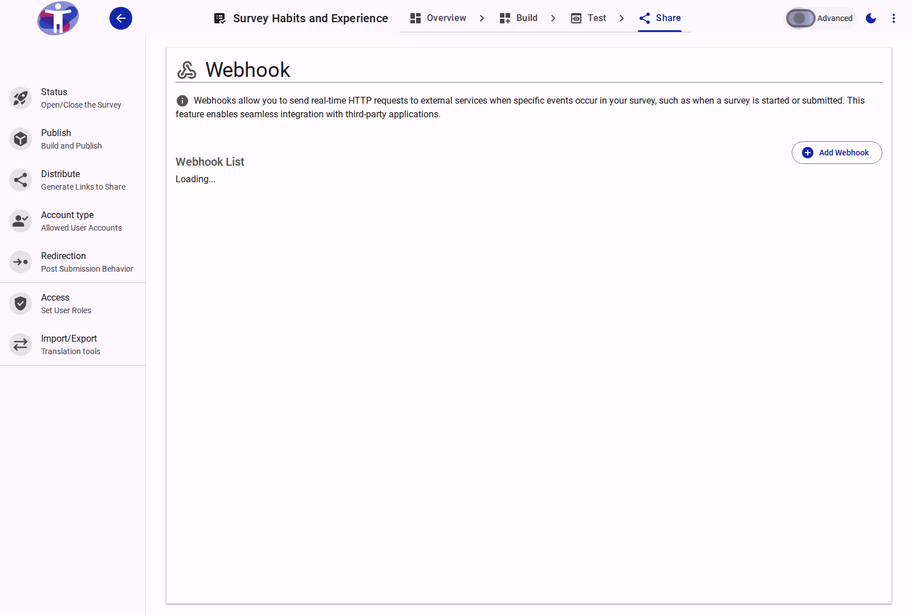
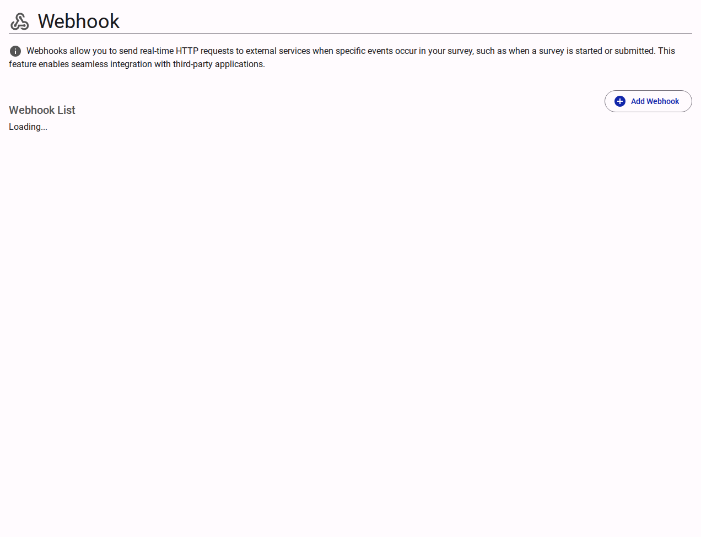

# Survey Webhooks

The **Webhooks** page provides controls to broadcast real-time survey event notifications to external HTTP endpoints, enabling programmatic workflows and third-party integrations.

<figure>
  
  <figcaption>The survey webhooks interface</figcaption>
</figure>

## Interface Overview

<figure>
  
  <figcaption>Webhook settings content</figcaption>
</figure>

Webhooks dispatch HTTP POST requests with JSON payloads whenever configured survey events occur.

### Adding and Managing Webhooks

Click **Add Webhook** to register an integration. Each webhook configuration contains three tabs:

### 1. Settings Tab

- **Name**: A descriptive name identifying the integration (e.g., "CRM Intake Pipeline").
- **Payload URL**: The target HTTP or HTTPS URL where webhook payloads will be delivered.
- **Secret Token**: An optional shared secret key used by the receiving server to verify the authenticity and origin of the payload.
- **Active Toggle**: Temporarily enable or disable outbound dispatches without deleting the configuration.
- **Triggers**: Select at least one event trigger to invoke the webhook:
  - **`survey.start` (Survey Start)**: Fired when a respondent begins a survey session.
  - **`survey.submit` (Survey Submit)**: Fired when a respondent submits their responses.
  - **`survey.terms.refused` (Terms Refused)**: Fired when a respondent declines the required survey terms.

### 2. Test Tab

The **Test** tab lets you verify your destination endpoint without running through a live survey:

- Click **Send Survey Start Event**, **Send Survey Submit Event**, or **Send Terms Refused Event** to transmit a sample payload.
- Inspect the immediate response:
  - **HTTP Status Code**: Visual status badge (e.g., `200 OK` or `500 Internal Server Error`).
  - **Response Time**: Round-trip latency in milliseconds.
  - **Response Body**: Raw response returned by your receiving server.

### 3. Events Tab

The **Events** tab displays an audit history of the latest webhook dispatch attempts:

- Review event timestamps, trigger types, delivery status, and payload details.
- Useful for monitoring integration health and diagnosing intermittent endpoint failures.

## Related Content

- [How to Set Up Webhooks](../../../how-to/webhooks.md) — Step-by-step configuration, secret verification and testing.
- [Platform API Reference](/api.html) — OpenAPI specifications for programmatic survey data operations
