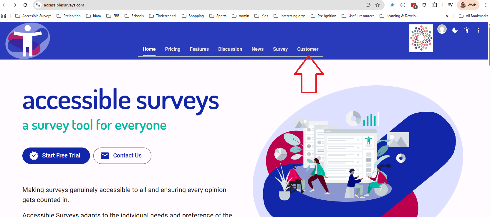
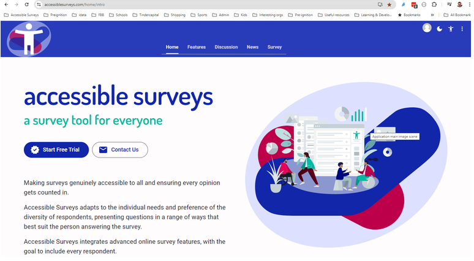

# Training Course Session 3: Translating Your Survey

## Overview

In Session 2, you added accessibility options. In this session, you will translate your survey into French and Spanish. The platform supports a wide range of languages, and this process applies to any language.

*Estimated time: 15-20 minutes*

## Learning Outcomes

By the end of this session, you will be able to:

- Add new languages for your 'Organization'.
- Translate your survey into newly added languages.
- Test the translated versions of your survey.
- Translate questions that are added or amended later.
- Understand how language options are presented to respondents.

## Activating Additional Languages

::: info
Only **Account Holders** can activate additional languages for their 'Organization', as this affects the organization's subscription plan.
:::

Languages are added via the 'Customer Portal'. If you created the account or were granted the role, you are an Account Holder.

Account Holders can access the 'Customer' portal from the homepage:

<figure>
  
  <figcaption>Homepage view for an Account Holder.</figcaption>
</figure>

Standard Team Members will not see the 'Customer' portal on their homepage:

<figure>
  
  <figcaption>Homepage view for a Team Member.</figcaption>
</figure>

::: info
If French and Spanish are not already available for your 'Organization', request an Account Holder to add them before proceeding with this session.
:::

## Written Steps

Use these steps with the video or on their own.

1. As an **Account Holder**, open **Customer Portal → Profile → Public** and enable French and Spanish for the organization.
2. Return to the survey, open **Build → Localize**, and add the new languages to the survey.
3. Open **Compose → Localize Mode** and translate the introduction, the questions, the options and the thank-you page.
4. Use the **Translate** action for a first pass, then review every string; machine translation is a draft.
5. Translate the email items if the survey will send confirmations or invitations.
6. Select **Test**, switch language in the test toolbar, and read the whole survey in each language.
7. When you later add or edit a question, return to Localize Mode and translate it; a missing translation falls back to the primary language.

## Instructions

Follow along with the video to translate your survey.

<lite-youtube videoid="JNZsL7pmPJQ"></lite-youtube>

## Further Reading

- [How to Create a Multilingual Survey](../how-to/localize-survey.md)
- [How to Use Import/Export to Translate Forms](../how-to/import-export.md)
- [Localize Reference](../reference/build/localize.md)
- [Multilingual Support (Listserv)](../../listserv/explanation/multilingual-support.md)

## Next Steps

::: info
Congratulations on completing Session 3! You can now proceed to Session 4, where you will learn how to test and share your survey.
:::

[**Start Session 4: Testing and sharing your survey**](session-4-distributing.md)
