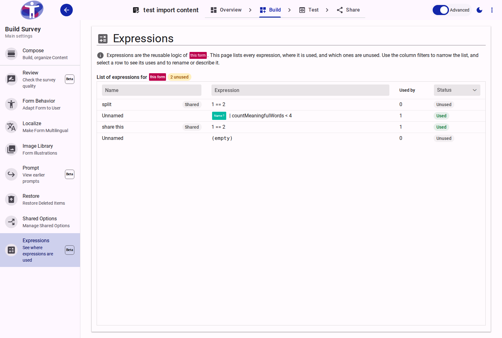

# Catch Issues Early, Stay in Touch Effortlessly

**Date:** 2026-10-20
**Version:** 2.2.0

Publishing a survey usually comes with two nagging questions: *Did I miss a broken condition, an accessibility barrier, or an untranslated question?* and *How do I invite a contact list or follow up with respondents without linking their answers to their email addresses?*

This release answers both — and makes complex survey logic much easier to maintain:

* A new **Review** workspace checks your survey from top to bottom across structure, logic, translation, accessibility, and content quality and lets you fix issues with a click.
* New **Team Audiences & Survey Invitations** let you import a reusable contact list in **Team Settings → Audiences**, compose and test multilingual invitation emails on **Share → Email**, distribute unique links (`/v2/{surveyId}/i/{token}`) from **Share → Distribute**, and track delivery, completion rates, and reminders in **Analytics → Progress** — without ever linking a respondent's answers to their address.
* The new **Email** tab under **Share** also handles submission confirmations, opt-in reminders, and follow-ups with respondent consent and automatic data expiry built right in.
* The new **Expressions** page gives you a single place to inspect and clean up every logical rule in your form.

---

## 1. Review Your Survey Before You Publish

You no longer have to click through every branch or wait for a build error to find out something is off. The new **Review** step sits right in the Survey Builder (between **Compose** and **Form Behavior**) and brings all quality and accessibility checks into one place.

<figure>
  
  <figcaption>The Review workspace: browse findings on the left, inspect the evidence and apply a one-click fix on the right.</figcaption>
</figure>

### Five check families, combining instant rules with AI review

* **Structure, logic and translation rules** run when you click **Run review** — catching empty sections, broken logic references, unused expression dependencies, unpublished shared sections, and missing translations. These rules are free; the model review runs alongside them. The editor keeps the survey structure live, but does not build the review findings until you ask.
* **Accessibility checks (rules + AI)** combine four deterministic checks with model-assisted plain-language review:
  * **Plain language (measured + AI):** Flags overly long sentences (over 25 words) and clusters of complex words (12+ characters), while the AI review (`accessibility.clarity`) spots jargon, unexplained acronyms, bureaucratic phrasing, and convoluted sentences that length rules alone cannot judge — offering a plain-language rewrite you can apply in one click.
  * **Descriptive link text:** Catches vague links like *click here* or *read more* so screen-reader users know where a link leads.
  * **Question control fit:** Warns when a question's input control doesn't match what its label asks for — such as an open text field asking for a date, email, phone number, URL, or number, a radio/dropdown asking to *select all that apply*, or checkboxes asking to *select one*.
  * **Theme colour contrast:** Checks your active light and dark themes against the WCAG AA 4.5:1 contrast standard so every text/background pair stays readable.
* **On-demand AI content review** looks at your survey the way a thoughtful colleague would — flagging leading or double-barrelled questions, repetitive items, and topics you might have missed.

### Fix issues on the spot

Most findings come with a direct action right inside the review panel, so you don't have to hunt through the form tree:

* **Plain-language and wording suggestions:** Click **Apply** to accept a clearer phrasing (with **Undo** if you change your mind).
* **Missing translations:** Translate a single item or every missing item in a language at once.
* **Broken or stale logic:** **Clear slot** on a dead reference, **Remove dependency** when an expression lists a binding it no longer uses, or jump straight to the rule.
* **Missing coverage:** **Insert** a suggested question or **Activate** an unpublished shared section.
* **Not relevant?** **Dismiss** any suggestion (you can always **Restore** it later).

::: tip Try it out
Open any survey and go to **Build → Review**. You'll also see small review markers right in the **Compose** tree and a final review summary in **Share → Build** just before you publish.
:::

* **Learn more:** [Review Reference](../app/survey/reference/build/review.md) · [Accessibility Checks](../app/survey/reference/build/review.md#accessibility-checks) · [Review Actions](../app/survey/reference/build/review.md#actions) · [Editor Markers](../app/survey/reference/build/review.md#editor-markers)

---

## 2. Respondent Emails — Without the Mailing List Headache

Want to send respondents a copy of their submission, nudge people who stopped halfway through, or share your findings once the report is ready? The new **Share → Email** page lets you do all three while keeping email addresses out of your survey dataset by default.

<figure>
  
  <figcaption>Each email type gets its own tab, with a subject and body for every language in your survey.</figcaption>
</figure>

### Three ways to reach respondents

1. **Confirmation:** Sent automatically as soon as someone submits their response.
2. **Reminders:** If a respondent opts in and leaves before finishing, the survey sends up to two gentle nudges. Switch on **Advanced** mode to customize how many reminders go out, how many days apart, and the cutoff date.
3. **Follow-ups (*Results and reports* & *Follow-up survey*):** Ready to share what you learned or invite people to phase two? Write your message, preview exactly how many opted-in respondents will receive it, and hit **Send**.

Every message is sent in the respondent's chosen language and includes a one-click unsubscribe link (no login required).

### How to set it up in 3 steps

1. In **Build → Compose**, add an **Email** question and check the purposes you need (*Confirmation*, *Reminders*, *Results and reports*, or *Follow-up survey*).
2. Go to **Share → Email** — you'll see a tab for each purpose you enabled.
3. Write your subject and message for each survey language.

### Privacy by design (and easy data cleanup)

* **Kept separate from answers:** Unless you explicitly check the **Dataset** purpose on the email question, email addresses stay out of your response data and exports.
* **Automatic expiry:** Consent records and the email addresses attached to them are automatically deleted after **180 days** (configurable in Advanced mode).
* **One-click Purge:** Need a clean slate after a study wraps up? Survey owners can now use **Purge data** to wipe collected responses, sessions, and consent records while keeping the survey structure intact. You'll get a clear preview of what will be removed before you confirm.

* **Learn more:** [Email Reference](../app/survey/reference/share/email/index.md) · [Reminders](../app/survey/reference/share/email/index.md#reminders) · [Follow-up Emails](../app/survey/reference/share/email/index.md#follow-up-emails) · [Purge Collected Data](../app/survey/how-to/purging-collected-data.md) · [Data Privacy and Security](../app/survey/explanation/data-privacy-and-security.md)

---

## 3. Audit and Manage Logical Expressions in One Place

When a survey has dozens of visibility rules and validation conditions, keeping track of which expressions are shared, where they are used, and which ones are left over from earlier drafts can be tedious. In **Advanced Mode**, the new **Build → Expressions** page lists every logical expression in your form — whether named (shared) or unnamed.

<figure>
  
  <figcaption>The Expressions page: filter by name, expression content, or usage status, and see how many expressions are unused at a glance.</figcaption>
</figure>

### What you can do on the Expressions page

* **See every rule in readable form:** Expressions are rendered with human-readable question and option labels rather than internal IDs, and you can filter the grid by **Name**, **Expression** text, or **Status** (*Used*, *Unused*, *Deleted ref*, or *Used · deleted ref*).
* **Trace where each expression is used:** Expand any row to see every question, section, page, or survey text that uses it, which logic slot it controls (*Hidden*, *Required*, *Read-only*, or *Invalid*), and click **Open in compose** to jump straight to that item.
* **Share, rename, or unshare in place:** Give an unnamed expression a **Name** and **Description** to make it reusable across your form, or clear its name to remove it from the shared picker without breaking items that already use it.
* **Clean up unused logic safely:** Delete unused expressions with confidence — deletion is automatically blocked if an active or soft-deleted item still references the expression, and any deleted expression can be recovered from **Build → Restore**.

* **Learn more:** [Sharing Logical Expressions](../app/survey/how-to/sharing-logical-expressions.md)

---

## 4. Team Audiences, Survey Invitations & Live Progress Tracking

When you already hold a list of people you have permission to contact — such as a research panel, a member directory, or workshop participants — you can now manage that list once at the team level, send each person a unique survey link, and track who has responded without compromising the anonymity of their answers.

### Build reusable lists in Team Settings → Audiences

Create named audiences in the Customer Portal and import recipients from a CSV file (`email`, plus optional `name`, `language`, and `external_id` columns, up to 10,000 rows and 5 MB). Each person is stored once per team even when they belong to several audiences, and the import preview shows created, updated, unchanged, suppressed, and invalid counts before you commit.

<figure>
  
  <figcaption>Manage reusable recipient lists in Team Settings → Audiences, with CSV import previews and column filters.</figcaption>
</figure>

### Write and test your invitation on Share → Email

The new **Invitation** tab on **Share → Email** lets you write a plain-text subject and Markdown body for each language in your survey, using `{{link}}` (required), `{{name}}`, `{{survey_title}}`, and `{{organiser}}` merge fields, plus an optional custom **Reminder email**. Click **Send test** at any time to preview the rendered email in your own inbox without creating an invitation record.

<figure>
  
  <figcaption>Write multilingual invitation and reminder emails and send yourself a test preview from Share → Email.</figcaption>
</figure>

### Distribute to an audience and choose your access mode

In **Share → Distribute**, the new **Invitations** section lets you pick an audience, choose between **Open** (the public link also accepts responses) and **Invitation only** (a valid `/v2/{surveyId}/i/{token}` link is required to submit), schedule up to three automated reminders, and review the exact eligible, suppressed, and already-invited counts before sending.

<figure>
  
  <figcaption>Choose an audience, access mode, and reminder schedule, then review the recipient breakdown before sending.</figcaption>
</figure>

### Follow delivery and participation in Analytics → Progress

Once sent, the new **Analytics → Progress** tab tracks every invitation wave in real time:

* **Funnel and rates:** See `Invited`, `Sent`, `Delivered`, `Link opened`, `Started`, and `Submitted` counts alongside `Response rate`, `Completion rate`, `Drop-off`, `Bounced`, `Unsubscribed`, `Complained`, and `Failed` tiles.
* **Masked recipient details:** Click **Load details** to filter recipients by status or language, download a masked status CSV, send a manual reminder (`Remind`), re-send an invitation (`Resend`), or replace a compromised link (`Reissue link`).
* **Strict anonymity boundary:** Organizers see *whether* an invited person responded, never *which answers* are theirs — no invitation ID, token, or email address ever enters a response document or dataset export.

<figure>
  
  <figcaption>Monitor the invitation funnel, completion rates, and masked per-recipient statuses in Analytics → Progress.</figcaption>
</figure>

* **Learn more:** [How to Send Invitations to a Team Audience](../app/survey/how-to/send-invitations.md) · [Team Audiences Reference](../app/customer/reference/team/audiences.md) · [Distribute Invitations Reference](../app/survey/reference/share/distribute/index.md#invitations) · [Invitation Progress Reference](../app/survey/reference/analyze/progress.md)

---

## Good to Know

* **You stay in control of AI:** AI review only runs when you click **Run review**, and it never edits your survey behind your back. Where AI credits are enabled, the panel shows the cost (1 credit per run) before you start.
* **Always up to date:** If you edit your survey after running a review, the panel lets you know your findings are from an earlier draft.
* **Safe testing:** Test submissions never trigger emails or create consent records, and **Send test** on the Invitation tab sends a preview only to the signed-in editor without creating an invitation.
* **Organization-wide suppression:** An unsubscribe, spam complaint, or hard bounce on an invitation adds a keyed hash of the address to a customer-wide suppression list that survives survey or audience deletion, ensuring people who opt out are never re-contacted.
* **Updated privacy policy:** Because the platform privacy policy now covers survey emails, invitation records, consent retention, and data purging, returning respondents may be prompted to re-confirm consent on their next visit.

## Related Documentation

* [How to Send Invitations to a Team Audience](../app/survey/how-to/send-invitations.md)
* [Team Audiences Reference](../app/customer/reference/team/audiences.md)
* [Email Reference](../app/survey/reference/share/email/index.md)
* [Distribute Reference](../app/survey/reference/share/distribute/index.md)
* [Invitation Progress Reference](../app/survey/reference/analyze/progress.md)
* [Review Reference](../app/survey/reference/build/review.md)
* [Sharing Logical Expressions](../app/survey/how-to/sharing-logical-expressions.md)
* [Compose Reference](../app/survey/reference/build/compose/index.md)
* [Localize Reference](../app/survey/reference/build/localize.md)
* [Share Reference](../app/survey/reference/share/index.md)
