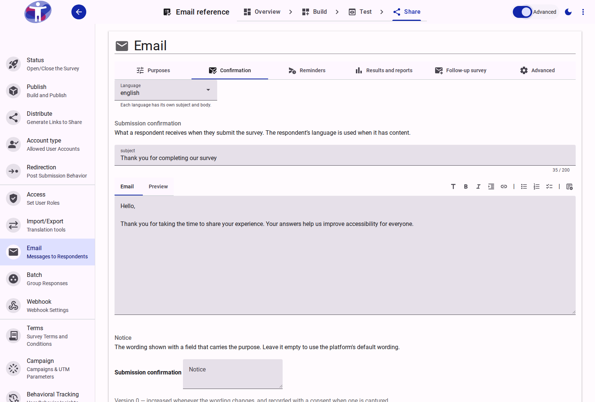

# Catch Issues Early, Stay in Touch Effortlessly

**Date:** 2026-10-20
**Version:** 2.2.0

Publishing a survey usually comes with two nagging questions: *Did I miss a broken condition or an untranslated question?* and *How do I follow up with respondents without collecting a spreadsheet of email addresses?*

This release answers both. A new **Review** workspace checks your survey from top to bottom and lets you fix issues with a click, while the new **Email** tab under **Share** handles confirmations, gentle reminders, and follow-ups — with respondent consent and automatic data expiry built right in.

---

## 1. Review Your Survey Before You Publish

You no longer have to click through every branch or wait for a build error to find out something is off. The new **Review** step sits right in the Survey Builder (between **Compose** and **Form Behavior**) and brings all quality checks into one place.

<figure>
  
  <figcaption>The Review workspace: browse findings on the left, inspect the evidence and apply a one-click fix on the right.</figcaption>
</figure>

### Two kinds of checks, working together

* **Structure, logic and translation checks** run when you click **Run review** — catching empty sections, broken logic references, unpublished shared sections, and missing translations. These rules are free; the model review runs alongside them. The editor keeps the survey structure live, but does not build the review findings until you ask.
* **On-demand AI review** looks at your survey the way a thoughtful colleague would — flagging confusing wording, repetitive questions, and topics you might have missed.

### Fix issues on the spot

Most findings come with a direct action right inside the review panel, so you don't have to hunt through the form tree:

* **Wording suggestions:** Click **Apply** to accept a clearer phrasing (with **Undo** if you change your mind).
* **Missing translations:** Translate a single item or every missing item in a language at once.
* **Broken logic:** **Clear slot** on a dead reference, or jump straight to the rule.
* **Missing coverage:** **Insert** a suggested question or **Activate** an unpublished shared section.
* **Not relevant?** **Dismiss** any suggestion (you can always **Restore** it later).

::: tip Try it out
Open any survey and go to **Build → Review**. You'll also see small review markers right in the **Compose** tree and a final review summary in **Share → Build** just before you publish.
:::

* **Learn more:** [Review Reference](../app/survey/reference/build/review.md) · [Review Actions](../app/survey/reference/build/review.md#actions) · [Editor Markers](../app/survey/reference/build/review.md#editor-markers)

---

## 2. Respondent Emails — Without the Mailing List Headache

Want to send respondents a copy of their submission, nudge people who stopped halfway through, or share your findings once the report is ready? The new **Share → Email** page lets you do all three while keeping email addresses out of your survey dataset by default.

<figure>
  
  <figcaption>Each email type gets its own tab, with a subject and body for every language in your survey.</figcaption>
</figure>

### Three ways to reach respondents

1. **Confirmation:** Sent automatically as soon as someone submits their response.
2. **Reminders:** If a respondent opts in and leaves before finishing, the survey sends up to two gentle nudges. Switch on **Advanced** mode to customize how many reminders go out, how many days apart, and the cutoff date.
3. **Follow-ups (*Results and reports* & *Follow-up survey*):** Ready to share what you learned or invite people to phase two? Write your message, preview exactly how many opted-in respondents will receive it, and hit **Send**.

Every message is sent in the respondent's chosen language and includes a one-click unsubscribe link (no login required).

### How to set it up in 3 steps

1. In **Build → Compose**, add an **Email** question and check the purposes you need (*Confirmation*, *Reminders*, *Results and reports*, or *Follow-up survey*).
2. Go to **Share → Email** — you'll see a tab for each purpose you enabled.
3. Write your subject and message for each survey language.

### Privacy by design (and easy data cleanup)

* **Kept separate from answers:** Unless you explicitly check the **Dataset** purpose on the email question, email addresses stay out of your response data and exports.
* **Automatic expiry:** Consent records and the email addresses attached to them are automatically deleted after **180 days** (configurable in Advanced mode).
* **One-click Purge:** Need a clean slate after a study wraps up? Survey owners can now use **Purge data** to wipe collected responses, sessions, and consent records while keeping the survey structure intact. You'll get a clear preview of what will be removed before you confirm.

* **Learn more:** [Email Reference](../app/survey/reference/share/email/index.md) · [Reminders](../app/survey/reference/share/email/index.md#reminders) · [Follow-up Emails](../app/survey/reference/share/email/index.md#follow-up-emails) · [Purge Collected Data](../app/survey/how-to/purging-collected-data.md) · [Data Privacy and Security](../app/survey/explanation/data-privacy-and-security.md)

---

## Good to Know

* **You stay in control of AI:** AI review only runs when you click **Run review**, and it never edits your survey behind your back. Where AI credits are enabled, the panel shows the cost (1 credit per run) before you start.
* **Always up to date:** If you edit your survey after running a review, the panel lets you know your findings are from an earlier draft.
* **Safe testing:** Test submissions never trigger emails or create consent records.
* **Updated privacy policy:** Because the platform privacy policy now covers survey emails, consent retention, and data purging, returning respondents may be prompted to re-confirm consent on their next visit.

## Related Documentation

* [Email Reference](../app/survey/reference/share/email/index.md)
* [Review Reference](../app/survey/reference/build/review.md)
* [Compose Reference](../app/survey/reference/build/compose/index.md)
* [Localize Reference](../app/survey/reference/build/localize.md)
* [Share Reference](../app/survey/reference/share/index.md)
