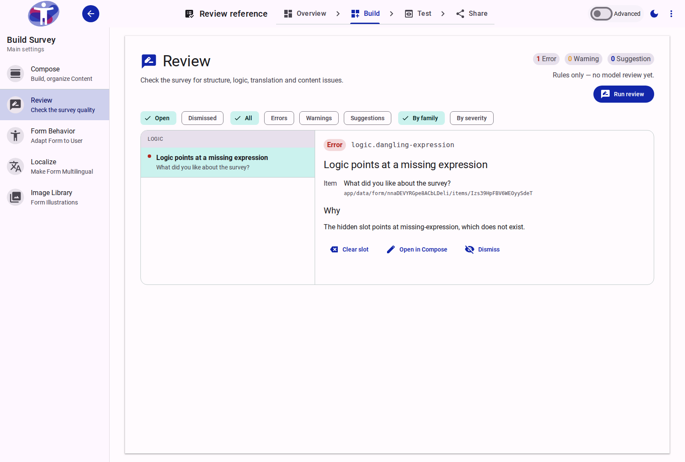
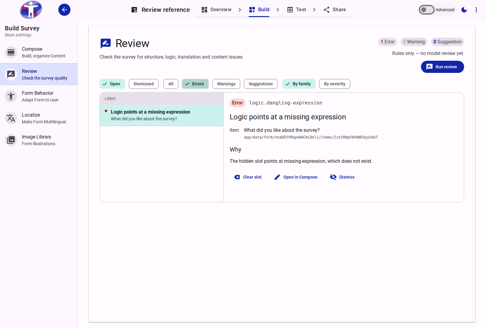

# Survey Review: Catch Quality Issues Before You Publish

**Date:** 2026-10-20
**Version:** 2.2.0

## Overview

The Survey Builder now has a **Review** workspace that brings every quality finding into one master–detail panel. Deterministic checks keep watching structure, logic and translations as you edit, while an on-demand model review suggests improvements to wording, repetition and coverage. Findings are grouped, filterable and actionable in place, so problems are caught before a survey is published rather than after respondents see them.

<figure>
  
  <figcaption>The Review panel combines rule findings and model suggestions, with the selected finding's evidence and actions beside the list.</figcaption>
</figure>

## What's New?

### One Review Workspace

* **What it is:** A new **Review** entry in the Survey Builder, between **Compose** and **Form Behavior**. It shows open counts by severity, a findings list grouped by check family or severity, and a detail pane with the item, its stored path, the reason and the proposed change.
* **Why it matters:** Authors no longer need to hunt through structure, logic and translation screens separately, or wait for a build to discover a problem. Every finding is visible in one place, with the context needed to decide what to do.
* **How to use:** Open a survey, choose **Build → Review**, then use **All / Errors / Warnings / Suggestions** and **By family / By severity** to narrow the list.
* **Read more:** [Review Reference](../app/survey/reference/build/review.md)

### Model-Assisted Content Review

* **What it is:** **Run review** sends the current form through the model review, which looks for unclear or leading wording, near-duplicate questions, and topics the survey intent implies but never asks about. Model findings are tagged **Model** and are suggestions in this release.
* **Why it matters:** Rules can verify structure, logic and translation completeness, but they cannot judge whether a question is double-barrelled or whether a survey forgot an important topic. The model review fills that gap without replacing the author's judgement.
* **How to use:** Select **Run review** in the panel header. Where AI credits are enabled, a run uses one credit and the panel states the price before you start. The review focuses on wording and coverage, not on whether a question uses a dropdown, text field or other control.
* **Read more:** [Review Reference](../app/survey/reference/build/review.md#review-runs)

<figure>
  
  <figcaption>The severity filter keeps the list focused; the header counts still describe every open finding.</figcaption>
</figure>

### Fix Findings in Place

* **What it is:** Each finding offers the action that fits it: **Apply** a proposed field text with **Undo**, **Clear slot** for a broken logic reference, **Translate this item** or **Translate all missing into ⟨language⟩**, **Insert** a suggested item, **Activate** an unpublished shared section, and **Dismiss** or **Restore**. Every finding with a tree row also offers **Open in Compose**.
* **Why it matters:** Most mechanical findings can be resolved without leaving the review, and an applied change can be undone immediately. Proposed new items still pass through the existing generated-content review queue.
* **How to use:** Select a finding and choose the action in the detail pane. Actions explain why they are disabled when an item is frozen, missing or cannot accept the proposed field.
* **Read more:** [Review Actions](../app/survey/reference/build/review.md#actions)

### Findings While You Edit

* **What it is:** In the Compose tree's settings mode, a review column marks items with open findings, coloured by the highest severity and badged when an item has more than one. The tree header also shows a findings count chip.
* **Why it matters:** Authors can see that a question or section needs attention while they are working on it, instead of discovering the problem at review time.
* **How to use:** Enable settings mode in the Compose tree, select a marker to open the Review panel filtered to that item, and use **Show the whole survey** to clear the focus.
* **Read more:** [Editor Markers](../app/survey/reference/build/review.md#editor-markers)

### Review at Publish Time

* **What it is:** The share flow mounts the same Review panel with the same actions, and folds in the build's stored report alongside the live rule and model findings.
* **Why it matters:** The final quality check now happens at the moment of publishing, with the build report and the review findings in one view.
* **How to use:** Open **Share → Build** and review the panel before publishing.
* **Read more:** [Review Reference](../app/survey/reference/build/review.md#publish)

## Fixes & Improvements

* Structure, logic and translation checks now surface empty sections, dangling logic references, unpublished shared sections, and missing translations in the Review panel as you edit.
* Review runs show a failed state with the incident message and a **Run again** action, and mark a run **Survey changed since this review** when the form has changed since it ran.
* Review runs are explicit: applying a fix does not start a new run, and re-runs are rate-limited.
* Where review metering is enabled, a run costs one AI credit and the run action is disabled while credits are loading, unavailable or exhausted.
* The model review prompt was tuned to avoid treating the choice of response control or response format as a content-quality finding.

## Notes

* Model findings are suggestions in this release. Promoting a check to a warning is a separate decision.
* Rule findings are computed locally and need no model call. Model findings require the review service; where metering is enabled, they also require an available AI credit.
* The Review panel currently covers structure, logic, translation and the three content checks. Sign-language and read-aloud coverage, per-mode markers, and portfolio-level review are not part of this release.

## Related Content

* [Review Reference](../app/survey/reference/build/review.md)
* [Compose Reference](../app/survey/reference/build/compose/index.md)
* [Localize Reference](../app/survey/reference/build/localize.md)
* [Form Behavior Reference](../app/survey/reference/build/behavior.md)
* [Share Reference](../app/survey/reference/share/index.md)
