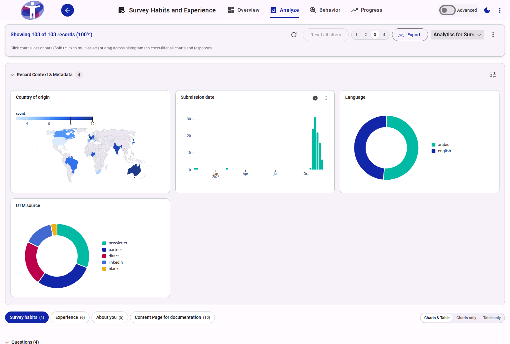
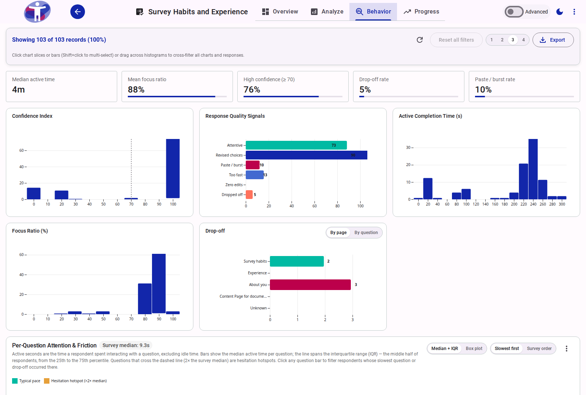

# Interactive Survey Analytics & Behavioral Insights

**Date:** 2026-11-18  
**Version:** 2.4.0

## Overview

Version 2.4.0 brings a major upgrade to how you explore survey results and understand respondent engagement. We have completely overhauled the **Survey Analytics** page with a fresh look and feel, flexible layouts, and an interactive response grid. In addition, a brand-new **Behavior** tab gives you unprecedented visibility into how people actually interact with your survey—helping you spot confusing questions, diagnose drop-offs, and keep your dataset clean.

---

## 1. Completely Revised Survey Analytics

While v1 already introduced instant click-to-filter capabilities, version 2.4.0 elevates the analytics workbench into a full-featured exploration environment with a modern design, richer visual hierarchy, and powerful presentation tools.

<figure>
  
  <figcaption>The redesigned Survey Analytics workbench: modern layouts, persistent metadata, and interactive question cards.</figcaption>
</figure>

### Key Improvements Over v1

* **Better layout and look and feel:** A cleaner, modern aesthetic with collapsible sections matching your survey composition, refined typography, and unobtrusive hover actions. You can easily adjust the grid density between 1 and 4 columns to suit your screen.
* **Interactive response grid:** Below the charts, a dedicated responses table lists every submission matching your active filters. You can sort and filter by individual column headers, and click any row to inspect the respondent's full answers in a clean dialog.
* **Persistent context & metadata:** Important survey background (submission dates, languages, countries, and campaign sources) now stays visible in a persistent top band as you move between survey pages. A settings button lets you choose which context cards appear and reorder them.
* **Pin key questions:** Star any important question to pin it to the top band. Pinned questions stay visible across all survey page tabs for easy comparison and filtering.
* **Tailor card styles and widths:** Choose between Donut and Horizontal Bar charts for choice questions, adjust card widths (1 column, 2 columns, or full width), and enjoy neater legends that comfortably fit longer labels.
* **One-click high-resolution image export:** Download publication-ready PNG or SVG images of any chart directly from its menu—no more taking blurry screenshots for your slide decks.
* **Saved views & universal sorting:** Save your favorite filters, layouts, and chart sorting into named views to revisit or share with teammates via direct links. Sort all charts at once by survey order, largest first, or smallest first.
* **Simpler data export:** The updated **Export** button in the toolbar downloads your full or filtered dataset in clean CSV or JSON format in seconds.

* **Learn more:** [How to Analyze Survey Responses](../app/survey/how-to/survey-analytics.md) · [Survey Analytics Reference](../app/survey/reference/analyze/survey.md)

---

## 2. New Behavioral Insights & Data Quality

Understanding *what* respondents answered is only half the story. The new **Behavior** tab reveals *how* respondents experienced your survey, highlighting points of confusion, fatigue, and potential data quality issues.

<figure>
  
  <figcaption>The new Behavior tab: track completion pace, spot hesitation hotspots, and audit data quality.</figcaption>
</figure>

### What You Can Do

* **Pinpoint drop-off locations:** See the exact page or question where respondents abandoned the survey before finishing. If people consistently leave at a particular question, you know exactly where to shorten text, clarify instructions, or adjust question flow.
* **Flag "Hesitation hotspots":** The system automatically measures typical reading pace and flags questions where respondents spent twice as long as normal. This spotlights confusing phrasing, double-barreled questions, or accessibility barriers.
* **Detect bots and speeders with Confidence scores:** Every submission receives a Confidence score (from 0 to 100) based on reading pace, answer adjustments, and typing patterns. Submissions completed impossibly fast or pasted in all at once are clearly flagged.
* **Safely remove low-quality or test responses:** Select suspicious entries or test submissions in the respondent table and exclude them from your analytical results with a clear reason. Excluded responses are immediately omitted from charts and exports, but remain safely stored in the archive and can be restored anytime with one click.
* **Inspect individual respondent timelines:** Click any respondent to open a visual timeline showing question-by-question dwell times and their slowest question.

* **Learn more:** [How to Analyze Respondent Behavior](../app/survey/how-to/behavior-analytics.md) · [Behavioral Analytics Reference](../app/survey/reference/analyze/behavior.md) · [Understanding Respondent Behavior & Data Quality](../app/survey/explanation/confidence-index.md)
