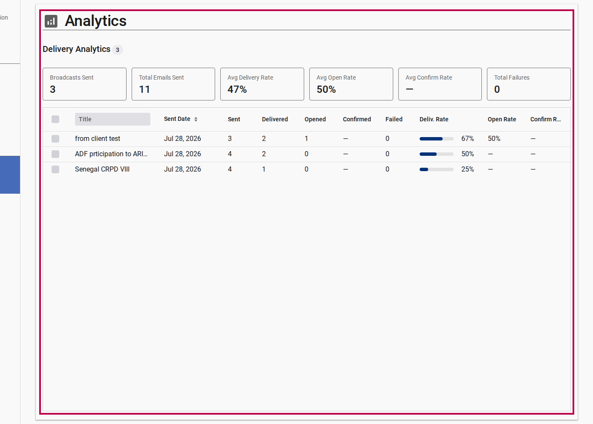

# Know Who Actually Received Your Broadcast

**Date:** 2026-11-23  
**Version:** 1.2.0

An email open only proves a tracking image was fetched — often by a security scanner or privacy proxy, not a reader. This release adds an optional confirmation button for recipients, reports confirmations in analytics, and filters provider prefetches out of **Opened**.

---

## What's New

### 1. Opt-In Confirm-Receipt Links

When composing or editing a broadcast, tick **Add a 'confirm you received this' link** to ask recipients to confirm they saw your message.

* **One-button confirmation:** Sent emails include a signed link in the footer that opens a simple, one-button confirmation page.
* **Off by default:** Confirmation is turned off for new drafts so you only ask for an extra step when verifying reach matters. Replies in a thread never carry the link.
* **Visible in preview:** The broadcast detail view displays **Confirm receipt — On** or **Off**, letting staff check the setting without opening the editor.

**Read more:** [Creating & Sending Email Broadcasts](../app/listserv/how-to/creating-and-sending-broadcasts.md)

---

### 2. Confirmed & Confirm Rate in Analytics

The **Admin → Analytics** page now tracks recipient confirmations alongside delivery and open metrics:

* **New metrics:** View a **Confirmed** count and **Confirm Rate** (`confirmed / delivered`) for each broadcast, plus an **Avg Confirm Rate** summary tile at the top.
* **Confirmation list:** Expand a broadcast row that asked for confirmation to see who pressed the button and when. Channel owners and editors can view this list; moderators cannot.
* **No misleading zeros:** Broadcasts sent without the confirmation link display **—** instead of `0`.

<figure>
  
  <figcaption>The Analytics page with the Avg Confirm Rate tile and the Confirmed and Confirm Rate columns.</figcaption>
</figure>

**Read more:** [Analyzing Broadcast Performance](../app/listserv/how-to/analyzing-broadcast-performance.md)

---

### 3. Open Counts Without Provider Prefetches

Automated checks by mail gateways and clients often fetch tracking images within seconds of delivery, inflating open counts. Tracking-image fetches within **two minutes of dispatch** are now treated as provider prefetches:

* **Excluded from open metrics:** Early fetches are left out of **Opened** and **Open Rate**. If the same recipient loads the image again after the two-minute window, that later fetch still counts.
* **Still transparent:** Whenever prefetches are excluded, a muted **N prefetched** note appears beneath **Opened** so you can still see the provider activity.

**Read more:** [Measuring Broadcast Engagement](../app/listserv/explanation/measuring-broadcast-engagement.md)

---

## Fixes & Improvements

* **Accurate delivery totals:** Recipients are no longer double-counted in delivery stats.
* **Legacy broadcast loading:** Older and seeded broadcasts now open without data-loading errors.
* **UI refinements:** Columns in the broadcast list are now resizable, and clearer guidance appears beside the confirmation option.
