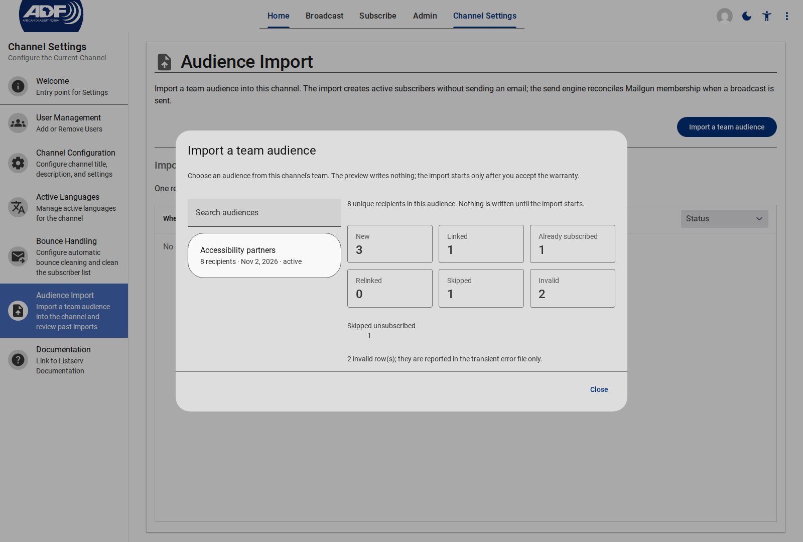
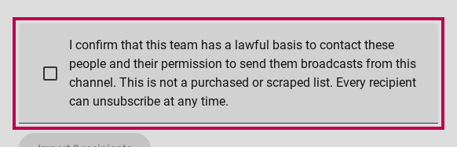
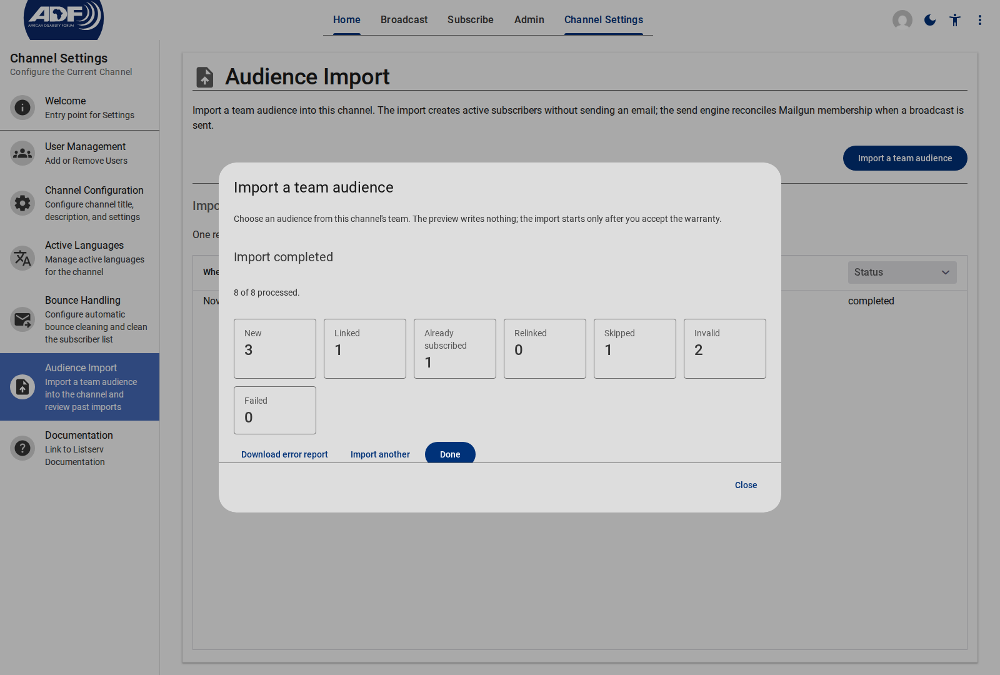
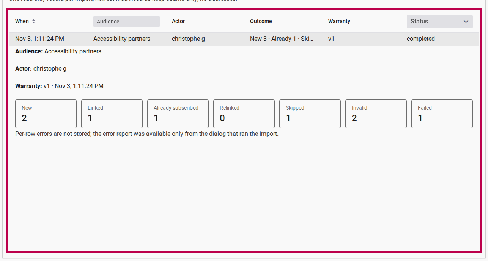

# Import an audience into your listserv channel

**Date:** 2026-11-03
**Version:** 1.1.0

## Overview

You can now seed a listserv channel from one of your team's reusable **Audiences**, instead of recreating a subscriber list person by person or asking everyone to subscribe again. The import previews what will happen, requires an explicit consent warranty, and keeps a read-only record of every run — without storing recipient addresses.

## What's New?

### Import a team audience in one pass

* **What it is:** A new **Audience Import** page under **Channel Settings** that turns a team Audience into active subscribers in one channel.
* **Why it matters:** Teams already maintain their contacts in reusable audiences. Reusing that list means a new channel can send to the right people immediately, with no duplicate account setup.
* **How to use:** Open **Channel Settings → Audience Import**, choose **Import a team audience**, pick an audience, review the preview, accept the warranty, and choose **Import**.
* **Read more:** [Import a team audience](../../app/listserv/how-to/importing-a-team-audience.md)

### Know exactly what the import will do

The preview classifies every recipient before anything is written:

| Outcome | What it means |
| --- | --- |
| **New** | A new subscriber record will be created. |
| **Linked** | The address already has an account; the subscriber uses that account. |
| **Already subscribed** | An active subscriber is left untouched. |
| **Relinked** | An active subscriber's missing account link is repaired. |
| **Skipped** | Pending, unsubscribed, bounced or suppressed recipients are never resurrected. |
| **Invalid** | Rows with a missing or malformed address. |

<figure>
  
  <figcaption>The preview reports counts only — it never lists recipient addresses</figcaption>
</figure>

### A consent warranty, kept with the record

Before the import starts, you confirm that the team has a lawful basis to contact these people and their permission to send broadcasts from this channel. The import records the warranty version and acceptance time, so the assertion is auditable later. The **Import** button stays disabled until the box is ticked.

<figure>
  
  <figcaption>The warranty is required once per import and stored with the import record</figcaption>
</figure>

### Resumable imports up to 10,000 recipients

One import handles at most **10,000 unique recipients**. You can close the dialog or leave the page while a large import runs; the import record keeps the progress. Reopening the dialog shows how far it got and offers **Resume** for a stale or failed run, continuing from the last processed recipient.

<figure>
  
  <figcaption>The result repeats the counts and offers the transient error report when rows were invalid or failed</figcaption>
</figure>

If any rows fail or have invalid addresses, download the `row,email,reason` error report, fix those rows in the audience, and import again. The report is generated on demand and is never stored.

### A read-only import history

Every import is recorded on the same page, newest first. The **Import history** grid shows When, Audience, Actor, Outcome, Warranty and Status, and filters by audience and status. Select a row to expand its details in place: actor, audience snapshot, warranty version and time, full counts and any failure.

<figure>
  
  <figcaption>Row details expand inside the grid; the record keeps counts and snapshots, not addresses</figcaption>
</figure>

## Privacy and delivery

* **No addresses in the record.** The import record and history keep counts, the actor, the audience name and the warranty evidence. They store no recipient addresses and no per-row errors.
* **The error report is transient.** It is the only address-bearing artefact and is available only from the dialog that ran the import.
* **No import-time email.** Importing an audience does not send a message to anyone.
* **No Mailgun membership at import.** The import does not add Mailgun list membership or set a `deliveryList`. The send engine reconciles each subscriber into their per-language list when a broadcast is sent.
* **No hidden account state.** Imported accounts are created without a password and without `accountIncomplete`, `subscribedChannels`, an unsubscribe token, a completion token or a preference mirror.

## What imported subscribers can do today

Imported subscribers **receive broadcasts** from the channel immediately. Private sent broadcasts and the preference page stay unavailable until the account-link flow ships: the account page reports them as not subscribed until that flow backfills the preference state. Password reset is their account path when they need to sign in.

## The 10,000-recipient first-send test

The import path is covered by the emulator scale test. The operational 10k first-send reconciliation test was closed as not planned, so no production recipients were contacted and no bulk pre-add was added. The send engine still reconciles Mailgun membership at dispatch, so the first real 10k send remains the observation point; a bulk pre-add would only be considered if that send exceeds the execution budget or drops active subscribers.

## Fixes & Improvements

* Idempotent re-runs: re-importing the same audience creates no duplicate subscribers or accounts, and re-running a failed import resumes the same record.
* Duplicate addresses in an audience collapse to one subscriber per address per channel.
* Archived audiences stay selectable for seeding a channel but are never modified by the import.
* The import is limited to the channel owner/editor, and the history honours the channel's owner/editor/moderator read access.

---

## Related Documentation

* [Import a team audience](../../app/listserv/how-to/importing-a-team-audience.md) — the step-by-step guide.
* [Listserv audience import spec](https://gitlab.com/christophe-g/lit-app/-/blob/main/specs/listserv-audience-import.md) — the full decision record.
* [ADR 0001: Subscriber backed by Firebase Auth identity](https://gitlab.com/christophe-g/lit-app/-/blob/main/app/app-listserv/docs/adr/0001-subscriber-firebase-auth-identity.md) — subscriber identity and account linking.
* [Team Audiences reference](../../app/customer/reference/team/audiences.md) — how teams store reusable recipient lists.
* [Creating & sending broadcasts](../../app/listserv/how-to/creating-and-sending-broadcasts.md) — what happens on the first send.
